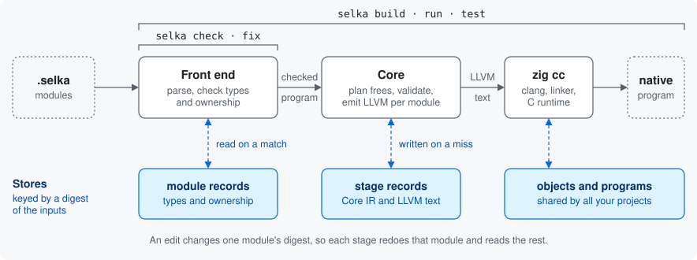

# Selka

Selka is a compiled language for code that AI agents write and people review. It reads like Python, runs like Zig, and
rebuilds in a fraction of a second after an edit, even in a 100,000-line program.

## Why it exists

An agent works in a loop: edit, build, test, read the errors, try again. Then a person reviews the result. Selka is
designed to make every step of that loop cheap.

**The loop is fast.** An edit recompiles only the modules it changes, and a test reruns only when the program behind it
changed.

| On a 99,000-line program | Cost |
|---|---|
| Rebuild after a one-line edit | 0.3 to 0.4 CPU-seconds |
| Type-check after an edit | 0.13 CPU-seconds |
| Build again with nothing changed | 0.01 seconds |

A 400,000-line program rebuilds after the same edit in 1.0 to 1.4 CPU-seconds.

**The programs are fast.** Selka compiles to native code through LLVM, with no garbage collector and no reference
counting: every value has one owner and is freed when that owner ends. Across the 31 programs of the
[benchmark suite][bench], the median run time is 1.03 times that of the same program in Zig (from 0.2 to 1.7 times).

**The code is easy to review.** You can judge a function from its own text:

- **What it can touch is in its signature.** Files, the network, the clock and even printing are parameters
  (`fs: Filesystem`, `out: Stream`). A function that takes none of them can only compute and return.
- **A call says what it does to its arguments.** `discount(mut orders, 25)` may change `orders`, `send(own orders)`
  gives them away, and a plain argument is only read.
- **Failure is in the return type.** `-> int fails str` can fail, and the caller has to handle it. There are no
  exceptions.
- **Nothing is hidden.** No closures, no methods, no inheritance, one spelling for each thing and one formatter.

**Mistakes are caught before the program runs.** The compiler checks types and ownership, and many of its errors carry
the exact edit that repairs them: `selka fix` applies it. A release that breaks working code ships its migration the
same way.

```selka
record Order:
    id: int
    cents: int


func discount(mut orders: Order[], percent: int) -> int fails str:
    if percent < 0 or percent > 100:
        fail "percent must be 0 to 100"
    mut total = 0
    for i in range(len(orders)):
        orders[i].cents = orders[i].cents * (100 - percent) // 100
        total += orders[i].cents
    return total


func main(out: Stream) -> int:
    mut orders = [Order(id=1, cents=1200), Order(id=2, cents=800)]
    const total = discount(mut orders, 25) else Err(message):
        print(out, "error:", message)
        return 1
    print(out, total)
    return 0
```

From the signature alone: `discount` changes the orders it is given and can fail with a message. It cannot print or
read a file, because nothing hands it a `Stream` or a `Filesystem`.

## How it works



Each stage stores what it produced under a digest of its inputs, so an edit reruns a stage only for the module that
changed. Tests work the same way: each runs in its own process, and a passing result is reused until the program behind
it changes.

## Status

Selka is experimental. This is version 0.1.1: it targets Linux on x86-64 only, and the language and its diagnostics
still change between releases.

<sub>The edit figures are CPU time (user plus system) with the release compiler, measured on 4 November 2026. The run-time
figures are the baselines recorded in [`bench/parity/thresholds.json`][thresholds], against Zig `ReleaseFast`.</sub>

## Install

You need Linux with glibc 2.31 or later (Debian 11, Ubuntu 20.04, Fedora 32) and an x86-64 processor with AVX2 (most
made since 2015). Download `selka-0.1.1-x86_64-linux.tar.xz` from the
[Releases page](https://github.com/eugenepentland/selka/releases), then:

```sh
tar -xJf selka-0.1.1-x86_64-linux.tar.xz
./selka-0.1.1-x86_64-linux/install.sh
selka --version
```

It installs under `~/.local` (`PREFIX=DIR` chooses another place) and needs nothing else: the download carries the Zig
that compiles the generated code. Put `~/.local/bin` on your `PATH`.

## Hello, Selka

Save this as `hello.selka` and run `selka run hello.selka`:

```selka
func main(out: Stream) -> int:
    print(out, "Hello, Selka!")
    return 0
```

`main`'s value is the process exit status.

## Tests live beside the code

A public function named `test_...` that returns `bool` is a test. `selka test FILE` or `selka test DIR` runs them.

```selka
func double(x: int) -> int:
    return x * 2

public func test_double() -> bool:
    return double(21) == 42
```

## Learn more

- The guides are online at <https://eugenepentland.github.io/selka/>, and `selka docs` prints the same pages.
  Start with `selka docs primer`, a one-page tour for Python programmers.
- `selka --help` lists the commands: `check`, `fmt`, `fix`, `test`, `build`, `run`.
- [examples/][examples-dir] holds small programs, from `factorial.selka` to an HTTP server and a project that calls C.
- [Ownership rules](docs/ownership-rules.md) and [the language guide](docs/python-syntax.md) have the details.

## Contributing

[CONTRIBUTING.md][contributing] says how to build the compiler and test a change. Selka is released under the
[MIT license][license].


<!-- Absolute, because the documentation site includes this page and publishes only the guides. -->
[bench]: https://github.com/eugenepentland/selka/tree/main/bench/parity
[thresholds]: https://github.com/eugenepentland/selka/blob/main/bench/parity/thresholds.json
[examples-dir]: https://github.com/eugenepentland/selka/tree/main/examples
[contributing]: https://github.com/eugenepentland/selka/blob/main/CONTRIBUTING.md
[license]: https://github.com/eugenepentland/selka/blob/main/LICENSE
