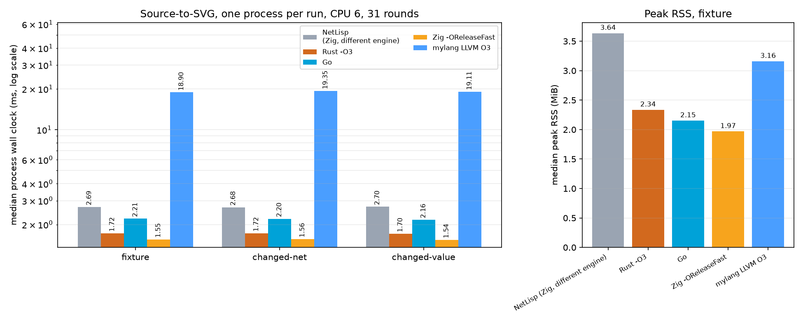

# Rust, Go and Zig ports of the mylang schematic pipeline

For the current mylang GC/arena builds, see the
[updated comparison and charts](real-arena-regions-2026-09-21.md#rust-go-and-zig-comparison).
The measurements below retain the earlier mylang baseline.

21 September 2026. **On one algorithm whose output is byte-identical in all
four languages, Zig ReleaseFast renders the LMX2595 module in 1.55 ms, the Rust
build at `opt-level=3` in 1.72 ms and Go in 2.21 ms. Mylang's LLVM O3 build of
the same pipeline takes 18.90 ms — 12.2× the Zig time, 11.0× the Rust time and
8.6× the Go time — and its step/frame-accounted configuration takes 46.45 ms
(29.9×). The EDA NetLisp engine, a different engine with a different algorithm
and different output, takes 2.70 ms on the same input.**

The three ports exist so that "mylang vs Go vs Rust vs Zig" can be asked of one
matched algorithm instead of four different programs. Each is a single source
file with no third-party dependencies, and each must reproduce the mylang
guest's SVG bytes exactly; `qualify.py` fails the run if any of them does not.

## What was measured

`src/schematic/guest/*.my` reads three documents (a module, a pinout and an
interface), validates them, builds the circuit model and net graph, places the
hub and its passives, routes every pin, and serializes one standalone SVG.
`experiments/full-svg-benchmark/ports/{rust,go,zig}` implement that pipeline
step for step — the same flat node list with `next` pointers, the same
validation order and issue codes, the same 128-pass net-graph relaxation with
its value-copy snapshots, the same row splitting and `branch`/`endpoint`
geometry, the same routing ladder, and the same byte writers. Where the guest
does something unusual the ports keep it, because the byte-identity requirement
makes each of those load-bearing.

The only structural difference is at the host boundary: the guest calls a native
provider once per byte (`io.byte`/`io.put`), while the ports read each document
once and write the finished SVG buffer once. That difference is part of what
the comparison measures, not an accident of it — the earlier audit counted
580,423 host calls on this fixture (530,800 byte reads, 49,617 byte writes and
six input/length calls), and 92.6% of those reads happen after model
construction.

| arm | source | configuration |
|---|---|---|
| `mylang-o3` | `src/schematic/guest/*.my` + `src/schematic/native_schematic.c` | LLVM backend, `--llvm-opt 3`, ReleaseFast |
| `rust-o3` | `ports/rust/main.rs` | `rustc -C opt-level=3 -C codegen-units=1 -C debug-assertions=off` |
| `go-fast` | `ports/go/main.go` | `go build` (default optimization; Go has no -O level) |
| `zig-o3` | `ports/zig/main.zig` | `zig build-exe -O ReleaseFast -fllvm` |
| `netlisp-llvm-fast` / `-safe` | EDA NetLisp engine at `2a8d9011` | Zig LLVM ReleaseFast / ReleaseSafe — different engine |

## Runtime

Median elapsed milliseconds, 31 randomized interleaved rounds after three
warmups, every process pinned to CPU 6 on the Intel Core i7-12700H. The timed
interval starts before launching the prebuilt executable and ends when it exits:
process start, reading the three documents, the whole pipeline, writing the SVG
to a private file and shutdown. Compilation, fixture preparation and output
verification are outside the timer. All 744 timed executions were checked
against the exact expected SVG hash for their case and arm.

| Implementation | fixture | changed-net | changed-value | ÷ zig-o3 (fixture) |
|---|---:|---:|---:|---:|
| **zig-o3** | **1.554** | **1.561** | **1.538** | 1.00× |
| rust-o3 | 1.720 | 1.723 | 1.704 | 1.11× |
| go-fast | 2.209 | 2.205 | 2.165 | 1.42× |
| netlisp-llvm-fast (different engine) | 2.695 | 2.678 | 2.705 | 1.73× |
| netlisp-llvm-safe (different engine) | 2.862 | 2.823 | 2.880 | 1.84× |
| mylang-o3 | 18.903 | 19.355 | 19.108 | 12.16× |
| mylang-o3-lto | 37.229 | 37.456 | 36.870 | 23.96× |
| mylang-o3-bounded | 46.452 | 46.791 | 46.715 | 29.89× |

Paired-bootstrap 95% intervals for the fixture ratios to `zig-o3`: rust-o3
1.06–1.19, go-fast 1.35–1.52, netlisp-llvm-fast 1.67–1.85,
netlisp-llvm-safe 1.75–1.93, mylang-o3 11.75–12.75, mylang-o3-lto
23.18–25.20, mylang-o3-bounded 28.99–31.38. They describe variation within
this batch on this machine, not uncertainty across machines or workloads.

The p10–p90 spread on the fixture is 1.37–1.72 ms (zig-o3), 1.55–1.88
(rust-o3), 2.02–2.42 (go-fast), 2.56–2.90 (netlisp-llvm-fast), 18.52–20.96
(mylang-o3) and 46.04–48.05 (mylang-o3-bounded). A machine with a residual
background load of about one core was used; the arms are shuffled per case and
per round, so that load is shared rather than assigned to one arm.



## Memory and code size

Median peak RSS from five separate `/usr/bin/time -f %M` executions per arm on
the fixture, and the binary that was timed:

| Implementation | peak RSS (MiB) | binary (bytes) |
|---|---:|---:|
| zig-o3 | 1.97 | 4,553,712 |
| go-fast | 2.15 | 2,376,085 |
| rust-o3 | 2.34 | 4,591,720 |
| mylang-o3 | 3.16 | 1,776,560 |
| mylang-o3-lto | 3.16 | 872,440 |
| mylang-o3-bounded | 3.47 | 2,148,640 |
| netlisp-llvm-fast | 3.64 | 13,910,120 |
| netlisp-llvm-safe | 3.53 | 11,197,432 |

Peak RSS includes code, runtime and data; it is not a live-heap measurement and
is small enough here that page granularity matters. Mylang's binary is the
smallest because the guest program is embedded and linked with `--gc-sections`;
the Rust and Zig binaries carry their standard libraries.

## What this establishes, and what it does not

**Establishes.** The schematic workload is not intrinsically expensive. The
same parse/validate/place/route/serialize pipeline, with the same 49,617 bytes
of output, runs in 1.5–2.2 ms in three compiled languages and 18.9 ms in
mylang. Whatever the remaining mylang gap is, it is in the compiler, the
runtime and the per-byte host bridge — not in the algorithm, which the ports
execute unchanged. On this workload the three native languages are within a
factor of 1.42 of each other, with Zig fastest, Rust 11% behind and Go 42%
behind.

**Does not establish.** This is not an isolated code-generation comparison.
The ports are separately written implementations, not mylang compiler output;
they replace per-byte host calls with bulk reads, and they are not equally
checked — Zig runs with ReleaseFast (no safety checks), Rust with
`debug-assertions=off`, Go with its ordinary bounds and nil checks and its
garbage collector. It is also one 30-component circuit, three documents of
25,845 bytes and one 49,617-byte SVG; no scaling claim to larger designs, and
no claim about cold caches, other NetLisp language features or the whole EDA
web pipeline. The NetLisp column is a different engine producing different
bytes (70,549) and is included only as a reference point.

## Qualification

- `qualification.json` — all eight arms on all three cases. The mylang family
  (`mylang-o3`, `-lto`, `-bounded`) and the three ports must agree byte for
  byte with each other; the independent model and geometry oracles in
  `tests/schematic_svg.py` and `tests/schematic_layout.py` check components,
  connected pins, NC pins, nets, ports and wire geometry on all of them. The
  NetLisp family is checked against its own evaluated model and compared to
  mylang across engines.
- `native-differential.json` — 19 documents (the valid fixture plus 18
  mutations of the module, pinout and interface) run through the mylang guest
  and all three ports. Every arm must report the same located issue as both its
  printed result and its process status, write nothing to stderr and publish no
  SVG; on the valid document the complete SVG bytes must match. All 57
  arm/document pairs agree. The mutations reach issue codes 1, 3, 4, 6, 11, 12,
  13, 14, 15, 17, 18, 19, 20 and 21. The Zig port was additionally fuzzed by
  its author over 1,700 structural and semantic mutations, compared against the
  Rust port, with no divergence; those scripts are left in the gitignored
  `.tmp/full-svg-benchmark-20260921/fuzz/` and are not part of the retained
  evidence.
- `native-provenance.json`, `native-check.txt` — toolchain versions
  (rustc 1.98.1, go 1.27.0, zig 0.17.0-dev.1683+5ceec001b), exact flags, source
  and binary SHA-256 values, and the per-case equality check. The binary hashes
  recorded by `measure.py` match the ones recorded by the build.
- `measurements.json`, `memory.json`, `measurement-summary.txt` — all 744
  individual timings, medians, p10/p90, paired-bootstrap intervals, peak-RSS
  samples and the hashes of the eight timed binaries.
- `provenance.json`, `netlisp-llvm-provenance.json`, `fixture-provenance.json` —
  the mylang compiler, EDA revision and frozen fixture inputs.

## Reproduce

```sh
python3 experiments/full-svg-benchmark/prepare_fixtures.py
python3 experiments/full-svg-benchmark/build_mylang.py
bash experiments/full-svg-benchmark/build_netlisp_llvm.sh
python3 experiments/full-svg-benchmark/build_native.py
python3 experiments/full-svg-benchmark/qualify.py
python3 experiments/full-svg-benchmark/differential.py
python3 experiments/full-svg-benchmark/measure.py --rounds 31 --warmups 3
MPLCONFIGDIR=$PWD/.tmp/mplcfg \
  /home/epentland/ai/canopy/rust-workflow/.venv/bin/python \
  experiments/full-svg-benchmark/charts.py
```

Timing needs an otherwise quiet machine: the harness pins every process to
CPU 6, but an early batch taken while a background load was active reported
every arm about 1.6× slower, ratios included, and was discarded.
