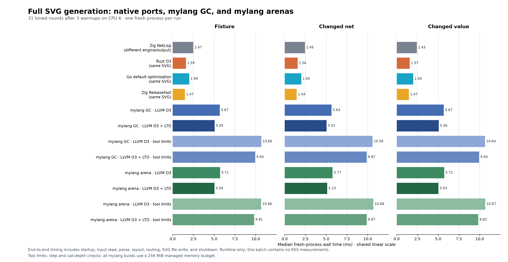

# Real arena regions and GC/arena benchmarks

L4 now uses native bump chunks for existing `with arena()` scopes. Both LLVM and
QBE use this runtime. The default memory policy is still tracing GC; no language
syntax or unchecked execution mode was added. L5 record/replay is separate work.

## Runtime change

Previously each arena object used a host `calloc` and the same 96-byte header as
a GC object, and closing a region walked the heap's object list. Arena payloads
now occupy aligned, zero-filled chunks. Compact side records retain descriptors,
element counts and payload offsets; they are 24 bytes on the supported x86-64
target. Scope exit frees chunks without visiting individual allocations.

Nested scopes, owner-region collection growth, runtime store barriers, static
escape diagnostics, deep-copy escape, frozen literals, byte views, and trap
unwinding remain checked. Only functions that open an arena save and restore
their entry depth; callees that do not open scopes retain the store barriers
without unnecessary frame bookkeeping. Heap-aware metadata queries replace assumptions that
every payload has a preceding GC header. This also fixes the frozen-buffer check
that made the earlier headerless experiment unsafe.

The total memory budget charges requested chunk bytes, including metadata,
alignment and unused capacity. Small budgets shrink chunks rather than bypassing
the limit. Arena allocations and superseded collection backing remain alive until
scope exit. Explicit individual release is a no-op for arena storage.

An arena can legally retain an older GC object. When collection runs, compact
descriptors scan arena contents for these outgoing references; arena objects are
never individually swept or queued for graph marking. Consequently this does not
implement the audit's strongest possible "never traced" optimization: mixed GC
references still require a scan. Automatic collection thresholds count GC bytes,
so arena growth alone does not cause collection. GC stress and collection on
budget pressure remain supported.

## Benchmark method

The [benchmark directory](../../experiments/svg-arenas-20260921/README.md) retains
scripts, source variants, compiler/runtime hashes, build receipts, qualifications,
allocator statistics and raw timing samples. The SVG sources differ only by one
existing `with arena():` around the entry body. Each policy has LLVM O3, LTO, step
accounting, and LTO plus step-accounting builds. The tool-limit runs use the same
100-million-step budget. All runs explicitly use a 256 MiB managed memory budget.

The full SVG comparison uses the actual retained EDA NetLisp renderer, original
circuit, changed-net circuit and changed-value circuit. Timings include process
startup, parsing, model/layout construction, SVG file output and shutdown, with
compilation and qualification excluded. They use randomized interleaving on CPU 6
and 31 measured rounds after warmups. GC stress is qualification only.

NetLisp uses a process arena, but has different algorithms, validation and SVG
output. The implementations share a checked geometry/model contract rather than
byte-identical SVG. GC and arena mylang output must be byte-identical to the
retained mylang references.

Standalone mylang executables already skip the final GC sweep on process exit;
the operating system reclaims that storage. Arena scope exit still frees its
chunks. Timings preserve both policies. Separate, untimed allocator probes use a private instrumented runtime to read
allocation peaks and post-entry state; they are not used for performance measurements.

The companion allocation workload builds 64 batches of 96 nested lists, each
containing 64 integers, and consumes every element in a checksum. Arena scopes
release each batch. This exercises repeated temporary allocation, unlike a single
SVG render whose model usually remains live until output completes.

## Validation

- 32 arena language tests and 64 native build/cache tests passed.
- All ten native-memory C suites passed with AddressSanitizer and UndefinedBehaviorSanitizer.
- `zig build test-native-heap -Doptimize=ReleaseFast` passed with assertions enabled.
- The LLVM O3+LTO escape-copy example returned 38 in both normal and GC-stress modes.
- The optimized compiler installation passed all 88 Guardian checks.

The C regressions cover nested release, older-owner growth, cycles/sharing during
escape, failed escape, budget exhaustion, alignment, zero filling, frozen buffers,
views of views, dynamic dictionary descriptors, GC objects retained only through
arenas and reclamation of unrelated GC garbage. The standalone C runner also had
three pre-existing test/API mismatches repaired; the evidence file explains each.

## Results

Original-circuit full SVG medians, milliseconds (lower is better):

| Mylang build | GC | Arena | Arena / GC, 95% paired interval |
|---|---:|---:|---:|
| LLVM O3 | 5.846 | 5.900 | 1.009 [0.994, 1.026] |
| LLVM O3 + LTO | 5.133 | 5.160 | 1.005 [0.976, 1.031] |
| LLVM O3 + tool limits | 10.997 | 11.144 | 1.013 [0.996, 1.024] |
| LLVM O3 + LTO + tool limits | 10.296 | 10.242 | 0.995 [0.985, 1.010] |

The actual Zig NetLisp renderer measured **2.481 ms** on the same circuit. The arena LTO build is 2.08 times NetLisp; the bounded arena LTO build is 4.13 times. Arenas do not close that application gap. Every original-circuit GC/arena interval includes 1.00; across the two changed inputs the ratios range from 0.980 to 1.024.

The SVG fixture makes only **134 managed allocations and zero normal GC collections**. Its arena arm uses three host chunks; peak charged storage is 458,752 bytes versus 301,000 bytes for GC. Chunks trade unused capacity for bulk allocation, so an arena does not always reduce peak memory. All 134 allocations are released before the arena entry returns.

The allocation-heavy workload improves from **7.238 ms GC to 6.170 ms arena**, a 14.8% elapsed-time reduction over 31 interleaved rounds. Both policies make 37,312 logical allocations; the arena serves them from 128 chunks. Peak managed storage falls from **4,318,528 to 196,608 bytes**, a 95.4% reduction. GC collects three times; all arena allocations are bulk released, leaving zero live chunks. These are runtime budget charges, not process RSS.

The first implementation added arena save/restore to every function and regressed SVG by 5–11%. Restricting that bookkeeping to functions that open scopes removed the regression. Valid pre-specialization timings are retained separately; early incomplete wrapper-based allocator observations were withdrawn and replaced with the exact private-runtime probes.

## Rust, Go and Zig comparison

The existing Rust and Go ports, plus the direct Zig port, were requalified and
timed together with the final GC/arena builds and retained NetLisp renderer.
This is a new measurement batch; it does not reuse the older native-port report's
18–46 ms mylang baseline. All 1,116 timed runs passed their exact SVG hash,
stdout, stderr and exit-status checks. Source and binary hashes match the
recorded builds. The method remains CPU 6, three warmups and 31 randomized,
interleaved measured rounds across three fixtures.

Median process elapsed time in milliseconds, including startup and SVG output:

| Implementation | Original circuit | Changed net | Changed value |
|---|---:|---:|---:|
| Zig port, ReleaseFast | 1.465 | 1.443 | 1.471 |
| Rust, O3 | 1.591 | 1.555 | 1.572 |
| Go, default optimization | 1.990 | 1.997 | 1.997 |
| Zig NetLisp, different renderer | 2.474 | 2.449 | 2.429 |
| mylang GC, LLVM O3 | 5.668 | 5.631 | 5.673 |
| mylang arena, LLVM O3 | 5.714 | 5.770 | 5.722 |
| mylang GC, LLVM O3 + LTO | 5.053 | 5.035 | 5.063 |
| mylang arena, LLVM O3 + LTO | 5.036 | 5.126 | 5.032 |
| mylang GC, LLVM O3 + tool limits | 10.664 | 10.576 | 10.639 |
| mylang arena, LLVM O3 + tool limits | 10.656 | 10.676 | 10.672 |
| mylang GC, LLVM O3 + LTO + tool limits | 9.931 | 9.871 | 9.936 |
| mylang arena, LLVM O3 + LTO + tool limits | 9.815 | 9.873 | 9.824 |

The arena LTO build takes 3.17 times Rust's elapsed time, 2.53 times Go's and
3.44 times the direct Zig port's on the original circuit. GC and arena LTO
medians remain close. These are implementation comparisons: the ports use bulk
input/output, while internal optimizations and checks differ. Rust, Go, the
direct Zig port and mylang produce byte-identical SVGs; NetLisp uses its own
renderer and produces different bytes.

Memory policies also differ: Rust uses owned vectors, Go uses its default GC,
the direct Zig port uses `init.gpa`, and NetLisp uses a process arena. Only the
mylang arena configurations use the new language regions. The explicit 256 MiB
managed memory budget applies to mylang; no equivalent budget is imposed on the
ports. This batch measures elapsed time, not peak RSS. Raw samples, qualification
and toolchain provenance are the `native-*.json` files in the benchmark directory;
the earlier arena-only and allocation-workload evidence remains unchanged.
