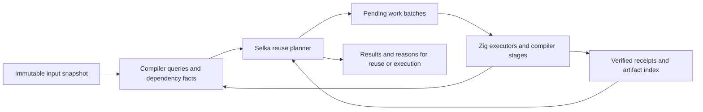

# Selka toolchain caching plan

Status: proposed implementation plan, 2026-10-10. No implementation or new
benchmark qualification is claimed by this document.

## Objective and contract

After a cold qualification, reuse every completed deterministic computation
whose complete inputs and execution contract are unchanged, for as long as its
evidence remains available. After an edit, execute only the requested work whose
dependencies changed, stopping propagation when recomputation produces the same
observable result. Share that evidence across commands and compatible worktrees.

This applies to compiler stages, native artifacts, tests, property cases, fuzz
campaigns, static checks, documentation and performance workloads. It should also
provide the eventual foundation for application-level memoization and incremental
queries from the old Weft design, and for explicit durable application steps
that recover from committed progress after a crash. Durable execution shares
the computation model and artifacts, with stronger retention and effect rules.

“Only edited code” means the affected dependency closure. A callee can change a
test's answer without changing its caller's machine code. Inlining, constants,
layouts, effect summaries and code-generation assumptions can require unchanged
callers to be recompiled. A parser or runtime edit can legitimately affect most
of a compiler's qualification suite. Exact minimal behavioral impact is not a
general computable guarantee; sound, fine-grained dependency tracking is the goal.

Fuzzing has completed campaigns, not a permanent proof that code is bug-free.
Wall-clock measurements are observations under a measurement context, not pure
function results. Live external services require fresh observations. These
distinctions belong in the result model, rather than appearing as exceptions to
an unconditional “everything passed” cache.

## Reviewed baseline

Primary review: `/home/epentland/ai/canopy/mylang-worktrees/codex-frontend-packed-20261010`,
branch `codex/frontend-packed-20261010`, committed HEAD
`ef6e0144fbe507d3b51f5512eec8d3465fd137a3`. The worktree was actively changing
during review, including semantic relocation instrumentation and packed stage
storage. Treat its unfinished changes as integration work, not qualified behavior.
Local `main` was `41ed360fb361c49938488ad111795bad8a726b73` at inspection.

Also reviewed the progressive self-hosting implementation in this worktree and
the earlier [interop plan](selka-zig-interop-plan-2026-10-09.md). Reconcile both
branches with their latest qualified revisions before implementation; this plan
does not propose overwriting either branch or replacing its caches.

The incremental worktree already contains:

| Area | Existing implementation | Remaining opportunity |
| --- | --- | --- |
| Frontend | Syntax, verdict, checked-body, specialization and summary reuse; stable declaration identities; dependency and record-shape guards | Reduce global metadata work and body restoration; publish compact dependency facts for other consumers |
| Core | Lowering artifacts, optimizer checkpoints/final metadata, demand-loaded bodies and LLVM receipts | Expose these as queries without materializing unchanged bodies to prove reuse |
| Native builds | Content-keyed units, linked programs and whole-build replay; per-user object sharing | Debug/optimized-debug units are still modules, specializations or helpers; Release is a whole-program unit |
| Guest tests | Per-test reachable-IR success receipts, whole-file/report replay, deterministic capability stand-ins and property seeds | Persist reusable dependency metadata; avoid rebuilding all test identities after a small edit; share receipts across compatible worktrees |
| Compiler's own tests | Zig build caches shards using binary, fixture manifests and environment inputs | Many dependencies remain broad; a new compiler binary invalidates many test actions |
| Performance | Native Juice build cache, immutable measurements, input/oracle identities and comparison checks | Select affected workloads and reuse compatible evidence automatically |
| Self-hosting | Independently built Selka test-index component, verified manifest and bounded protocol | That component is informational; it does not authorize test skipping |

Important integration locations in the incremental worktree:

- `src/incremental.zig`, `semantic_cache.zig`, `semantic_copy.zig`,
  `cache_key.zig`, `dependency_report.zig` and `function_identity.zig`.
- `src/core/stage_store.zig`, `lowering_cache.zig`, `optimization_cache.zig`,
  `emission_cache.zig`, `emit_units.zig`, `unit_cache.zig` and `build_replay.zig`.
- `src/core/test_runner_identity.zig`, `test_runner_receipt.zig`,
  `test_runner.zig`, `test_runner_directory.zig` and `test_runner_affected.zig`.
- `src/core/juice/{engine,manifest,collectors,report,inventory}.zig`,
  `build.zig`, `build_test_inputs.zig`, `scripts/affected_tests.py` and
  `src/doctest_command.zig`.

Two distinctions must survive the integration:

1. `tests_index.callGraph` deliberately omits unresolved function-value calls.
   It is unsuitable as the authority for skipping tests. The Core receipt graph
   includes calls and function references, with a conservative fallback when
   metadata cannot be represented.
2. The compiler's existing counters separate work performed from artifacts
   restored. The retained checkpoint experiment reports 1/1/3 fresh lowering,
   optimization and native-unit compilations for entry/helper/three-file edits,
   while still materializing substantially more bodies. A native unit is not
   necessarily one function. Preserve that distinction in every claim.

The retained experiment also reports 237,589 files and 3.234 GiB allocated cache
space after a fully cold 510k-line fixture build. That is evidence for compact
metadata and packing, not a measurement of the unfinished packed worktree.
See its `experiments/checkpoint-reuse-20261009/README.md` and
`experiments/demand-artifacts-20261009/README.md` for methods and limitations.

## Architecture: one dependency model, several result contracts

Use a shared query/action protocol over existing stores. Migrate producers one
at a time. A unified model does not require one physical file format or identical
policies for native objects, test receipts and performance records.



### Identities and dependency facets

Keep a stable logical ID separate from a content digest. Inserting a declaration
must not rename unrelated queries. Use package/module/declaration identities,
specialization arguments and operation kinds; never durable arena ordinals.

Give dependencies the facet a consumer actually reads:

| Facet | Typical readers | Example invalidation |
| --- | --- | --- |
| Signature and public contract | Type checking callers | Parameter type, effect ceiling or visibility changes |
| Body / normalized checked IR | Lowering and execution closures | Implementation changes |
| Layout, constants and embedded assets | Layout consumers, constant evaluation and code generation | Field layout or embedded file contents change |
| Inferred effects, mutation, ownership and parameter facts | Global checking and optimization | A callee gains an effect or an optimization assumption changes |
| Optimized body and consumed optimization summaries | Inlining and other dependent transforms | An inlined callee changes |
| Debug positions and observable source metadata | Diagnostics, debug objects, stack traces and snapshots | A reached source location moves |
| Discovery and resolution | Test/module inventories, name lookup and indirect targets | A test is added, an import changes, or an absent name becomes present |
| Execution inputs | Test/fuzz/performance actions | Fixture, provider, generator, seed, oracle or runtime changes |

Do not make an ordinary caller's object depend on every callee body. Do make its
test execution depend on the implementations it can reach. Record negative name
lookups, missing files, directory/glob membership and possible indirect target
sets. Revalidate discovery so new tests and newly reachable code cannot disappear
behind an old successful report.

Recursion needs strongly connected dependency groups. Propagate effect and other
recursive summaries to a fixed point within a group, then publish its result.
Unexpected query cycles should be diagnosed, not mistaken for cache hits.

Separate semantic and source-position identities only where their observability
is understood. Current test keys include source positions; keep that behavior
initially. A comment edit can avoid semantic work while still requiring new
debug information or diagnostics. Never replay a stale source location to gain
a prettier reuse count.

### Query and action receipts

A conceptual receipt contains:

```text
logical ID, operation kind, schema version
producer implementation and execution contract
ordered dependency reads with facet and observed fingerprint
output fingerprint and referenced artifact digests
eligibility, completion status and evidence kind
reuse/retry policy and retention/durability contract
run and step occurrence identity when scoped to a durable execution
```

The lookup identity binds the operation, canonical arguments, producer and
relevant target/tool/runtime/flags/provider settings. Before admitting a previous
result, validate its dependency reads against the current snapshot. A changed
control dependency requires recomputation before following obsolete dependent
reads. Replace the dependency set after recomputation, including removed reads.

Compare output fingerprints to stop propagation when the result is unchanged.
Equality must include all downstream-observable output, including relevant
diagnostics and metadata. Keep artifact contents in the store and compact hashes
in the graph; do not load a whole typed body just to discover that it is reusable.
This follows the established demand-driven, red/green query approach described
in the [Rust compiler guide](https://rustc-dev-guide.rust-lang.org/queries/incremental-compilation-in-detail.html).

Classify results explicitly:

- **Deterministic result:** reusable while every input and contract is unchanged.
- **Completed exploration:** a particular property/fuzz seed range or campaign
  was completed; only that evidence is reusable.
- **Measurement:** observations under a collector, environment and sampling
  policy; a request for fresh timing still executes.
- **Live effect:** external state is untracked; execute when the gate requires it.
- **Recorded effect:** an outcome retained for one durable execution step;
  replay it within that run under its recovery contract. It is not a globally
  reusable result for every invocation with the same arguments.

Store failures as diagnostic evidence if useful, but retain the current initial
admission rule: only complete successes satisfy a test gate. Timeout, cancellation,
refusal, flaky retries, partial batches and corrupt records never become passes.
An incomplete action can contribute independently completed child cases.

### Requirements for future durable applications

Keep the implementation waves below. Wave 1 should specify these boundaries so
the eventual durable runtime can use the same foundation. It does not need to
implement a workflow engine or journal effectful applications yet.

1. **Separate computation identity from execution identity.** A pure chunk
   transform can share a result across runs by code, input and settings. A
   durable operation also has a run ID and a stable step/occurrence ID, including
   repeated loop items. Two intentionally distinct writes with identical
   arguments remain distinct operations. Retries of one operation keep the same
   idempotency identity; an attempt number must not turn a retry into a new effect.
2. **Separate disposable results from retained recovery state.** Cache artifacts
   may be evicted. A durable run pins its journal, captured inputs, code version
   and state needed for recovery until explicit completion/release or the
   configured retention policy permits deletion. Suspended runs survive process
   leases expiring. Storage limits must produce backpressure or an explicit
   failure rather than silently delete required history.
3. **Define a durable commit boundary.** Persist and validate a step's output
   before committing a journal record that references it, and acknowledge the
   checkpoint only after the configured durability guarantee is met. For local
   power-loss recovery, that includes the required data and filesystem metadata
   flushes; atomic rename alone is not the durability contract. Torn or partial
   records are never completed checkpoints. Group commits can bound overhead,
   with the possible repeated work stated explicitly.
4. **Declare replay and retry behavior.** Pure unfinished work may run again.
   Clock/random/external-read results need recorded values or immutable snapshots.
   External writes need a transaction, an idempotency protocol or reconciliation
   with the destination. A crash after a write but before its acknowledgement
   leaves an uncertain outcome; losing its receipt does not authorize blindly
   repeating it. Require adapters for untracked Host/FFI operations.
5. **Version the run and its state.** Retain executable/implementation identities,
   step schemas and serialization versions. Resume against the original code and
   captured inputs, or use an explicit migration. A new run under edited code may
   reuse compatible pure artifacts, but cannot silently reinterpret an existing
   effect history. Store serializable state or artifact references, not process
   pointers, file handles or transient planner handles.

Expose separate cache-publication and durable-commit capabilities over any shared
store implementation. Existing best-effort cache publication cannot claim durable
completion. Missing recovery history is an explicit recovery failure unless the
operation's contract establishes a safe reconstruction. Concurrent recovery needs
exclusive ownership or fencing so a stale worker cannot commit another effect.

This supports a future CSV job with an immutable source, stable chunk identities,
committed chunk outputs and aggregation state, followed by recoverable publication
of the final file. It resumes at committed steps; it does not require restoring
an arbitrary native stack or checkpointing every function call.

### Selka ownership and Zig ownership

Extend progressive self-hosting with a `cache_plan` component, separate from the
informational test index. Selka initially owns pure graph operations, affected
closure calculation, receipt planning and explanations. Zig owns source/Core
fact extraction, canonical hashing, filesystem access, process execution,
resource limits, artifact validation and atomic publication.

Use one bounded batch exchange per planning operation, not one subprocess per
function. Keep large IR and AST values in their existing stores. The next step
can be a persistent Selka planner with session-scoped handles and revision tokens
if measurements justify it. An in-process ABI is not required to start.

The planner receives immutable snapshots and returns work IDs. Accept completion
only for the same pending work, snapshot and producer identity. A new edit cannot
publish a stale completion as the current result. Deduplicate concurrent requests
for the same reusable computation or the same durable step occurrence, according
to its policy. Cancellation and worker failure release transient claims; they do
not release durable history or establish that an external effect did not occur.

Every early replay path must bind the verified planner implementation before it
can return a result: directory/report replay, tool tickets, whole-file receipts,
per-test receipts and, when integrated, compiler build replay. Updating only a
final key would leave old fast paths incorrectly eligible.

Keep the qualified seed and independent component build arrangement. Bootstrap
must not require the planner it is building. Component qualification and the
reference/shadow oracle need an execution path that cannot be satisfied by the
component's own unverified skip decisions.

## Implementation waves

### Wave 1 — Establish the reuse contract and self-host Core traversal

This is the recommended next stopping point. It creates a sound extension point
without rewriting the compiler caches or waiting for packed storage to finish.

1. Pin the latest qualified incremental and self-hosting revisions on an
   integration branch. Record baseline work counts and current cache admission.
2. Specify operation/receipt identities, graph completeness, snapshot ownership
   and reasons for reuse/miss. Add a machine-readable planning/explanation report;
   exact CLI spelling can follow the existing work-report conventions. Define the
   future run/step identity, retention, commit and retry-policy boundaries above;
   ordinary compiler caches remain disposable, and unsupported durable contracts
   must be rejected rather than approximated by best-effort caching.
3. Port `test_runner_identity.Shared.reach` into the new Selka component.
   Preserve ordered root contributions, sorted non-root digests and multiplicity;
   keep Core canonicalization and `.call`/`.func_ref` extraction in Zig.
4. Add component identity to all test replay paths before enabling its decisions.
   Preserve the existing per-test fallback, property/invariant roots, source
   providers, host restrictions and unknown-metadata behavior.
5. Qualify in reference and shadow modes, then enable the component for the
   existing receipt traversal. A failed or invalid component must never mean
   “nothing affected”; retain explicit reference execution for recovery.

Deliver as three reviewable changes: contract/reporting; component plus shadow
parity and identity wiring; production integration plus the edit qualification
matrix. A port alone is not claimed as a speedup; measure its transport cost.

Exit: identical unedited deterministic suites execute zero tests; editing a
helper reruns its dependent tests and reuses unrelated receipts; callback,
constant, provider, discovery, planner-only and corrupt-cache changes behave
correctly. A component edit rebuilds independently of the Zig host.

### Wave 2 — Persist dependency facts and make planning proportional to edits

Adapt existing frontend/Core caches to the shared protocol. Publish compact
function summaries, typed dependency facets and output fingerprints while doing
the work already required by the incremental compiler. Persist reverse edges
and test-root closure summaries. Batch closure calculation and use recursive
groups so every test does not walk the entire program again.

An unchanged test's key should become verifiable from those records without
lowering its whole program. Keep the current reachable-IR key path as an oracle
until equivalence is demonstrated. Never drop global validation merely because
body checking was reused: move each required effect, mutation and resolution
analysis into a correctly invalidated query first.

Integrate the packed-stage work behind the store interface once qualified.
Separate logical query schemas from pack/compression versions. Use bounded,
independently readable blocks and compact indexes so a cache hit does not require
decompressing unrelated IR. Extend streaming hashing to store operations that
still allocate complete artifacts; the component coordinator already streams.

Treat native granularity as a separate measured change. Prototype stable
function or small-group units for the development mode, including symbol,
constant, debug and linkage ownership. Compare native process count, linker
time, object count, cold build, edit build and runtime. One object per function
can make the overall build slower. Keep whole-program Release until a separately
qualified incremental optimization/link strategy preserves its intended quality.

Exit: small private edits only recompute dependent queries; metadata work,
restored bodies and bytes read are measured separately from fresh compilation.
The 191k/510k fixtures must show scaling improvements without changing program,
trap or debugger behavior. No “one function recompiled” claim while a whole
module still goes through native compilation.

### Wave 3 — Cover the entire verification command

Register adapters for guest tests, compiler Zig tests, CLI/integration tests,
doctests, format/lint checks, generated interfaces, fixture generation and
Guardian checks. Preserve their current commands and success criteria. The
top-level gate inventories all required actions, then satisfies each by a valid
receipt or execution. “Not selected” is distinct from “passed previously”.

Guest tests can use compiler-provided dependency facets. While the compiler is
mostly Zig, its own tests start with exact executable/tool/fixture/command keys
or independently built module/shard keys. Selka cannot infer sound function-level
dependencies inside arbitrary Zig binaries. `scripts/affected_tests.py` is a
useful prioritizer and explicitly not a full gate; do not promote its textual
heuristics into proof that a test can be skipped.

Split broad test input lists only with evidence about everything they read.
Capture C include dependencies, generated headers, libraries and relevant
environment before admitting foreign-code results. Preserve current refusals
for untracked Host/FFI behavior. Isolate tests from shared process/global state,
or make setup, ordering and reset behavior part of the action contract.

Formatting can key by file bytes and formatter. Lint/Guardian global checks
must also key their repository/configuration scope, rules and baselines. Doctest
keys include extracted snippets, expectations, language/compiler and imported
inputs; documentation navigation/rendering remains a separate result.

Existing `--force`, `--verify-facts`, leak-check and rerun controls retain their
meaning. Separately modeled sanitizer/leak/fact-qualification actions may later
reuse their own complete evidence; an ordinary passing test cannot satisfy them.

Exit: an unchanged normal gate launches no cacheable test/check workers, while
still checking its inventory and running actions explicitly requiring freshness.
Fixtures, added/deleted tests, environment, rules and tool changes invalidate the
right actions. A new compiler may still invalidate a broad suite legitimately.

### Wave 4 — Incremental property testing and fuzzing

Extend the current property runner, whose receipts already include seed and run
count, with stable case ordinals and completed ranges. Key each range by target
closure, generator/shrinker/oracle, provider, instrumentation and input-generation
contract. Increasing a qualified campaign from 1,000 to 2,000 cases should run
only the additional cases when the generator supports stable indexed generation.
Preserve attempted/discarded-input semantics; a run-count change alone is not a
proof that an old prefix matches a new one.

Register compiler differential fuzz drivers as explicit actions too: generator,
reference compiler/oracle, candidate compiler, harness, flags, fixtures and seed
ranges all belong in their identity. A candidate compiler change may invalidate
every prior differential result even when generated source is unchanged.

For coverage-guided fuzzing, persist input corpora, minimized crashes, coverage
schema, engine version, configuration and campaign evidence. Keep independent
target shards. Select targets whose transitive dependencies changed, replay their
retained corpus on the new target, then spend new exploration budget there.
Coverage from an old binary is not proof about the new binary. Deterministic
campaign continuation also needs engine state or explicitly independent seed
shards; a corpus plus an integer seed is not a universal checkpoint.

Use observed coverage to prioritize affected paths, not as the sole authority
for excluding code that a prior input never reached. Retain broader scheduled
exploration to discover untested interactions; ordinary edit gates can reuse
unchanged completed campaigns. This extends, rather than replaces, the corpus
model in [LLVM's libFuzzer documentation](https://llvm.org/docs/LibFuzzer.html).

Exit: unchanged qualified ranges execute zero cases; budget extension executes
only new ranges; edited dependencies replay the relevant corpus and explore
again; cancellation resumes completed ranges without reporting an unfinished
campaign as passed.

### Wave 5 — Incremental performance evidence through Juice

Use Juice's existing workload manifests, immutable records, build identities,
oracles and comparison rules. Add workload-to-code/data dependency manifests
and an automatic evidence lookup. Include harness/setup/teardown, providers,
inputs, output verification and measurement configuration in each workload.

Cache static cost/fact analyses as compiler queries. Cache reproducible counting
runs only within a fully specified execution and instrumentation contract; keep
their raw evidence. Existing Juice instruction counts are a performance proxy,
not a guarantee of elapsed time, and allocation counters retain their documented
allocator-dependent meaning.

An edited helper schedules every benchmark that can execute it, even if the
benchmark body itself is unchanged. A harness that starts directly at the
affected operation can avoid expensive setup; a function-level counter region
alone still executes setup. A previously cold path needs coverage review or a
new workload, not an assumed zero performance impact.

Physical measurements must include relevant executable/link layout, runtime and
library contents, collector/version/events, CPU/OS context and sampling policy.
Unrelated code can move addresses and affect physical performance, so a changed
whole-program binary is not automatically equivalent for native timing. Keep
isolated microbenchmarks for locality and representative end-to-end workloads
for system effects.

Separate reusable measurements from comparison decisions: a changed performance
threshold can re-evaluate old compatible samples; changed instrumentation or a
request for fresh wall-clock timing executes again. Keep periodic whole-system
timing and calibration outside the cheap deterministic edit gate.

Exit: unchanged compatible requests reuse records; edits schedule affected
workloads; threshold-only changes rerun comparison; changed measurement context
never inherits an incompatible result or silently claims a fresh measurement.

### Wave 6 — Sharing, retention and the no-op floor

Share immutable artifacts and eligible action receipts locally across worktrees;
keep mutable source snapshots and revision indexes private to each worktree.
Use workspace-relative logical names and explicit path mappings where semantics
allow them. Absolute paths currently occur in test keys/debug outputs. Do not
strip them blindly: first prove that path-sensitive behavior and diagnostics
remain correct. Reverting to a retained revision should recover its old results.

Support atomic publication, concurrent same-key work, bounded memory/disk,
crash recovery, GC roots/leases and explicit cache format compatibility. A
missing or damaged cache result falls back to work; an invalid configured
component is an error, not a fake cache miss yielding success. Eviction must
never delete a running action's only live input. Same-key differing outputs are
a determinism error to investigate, not last-writer-wins evidence.

For future durable users, GC must also honor persistent run roots independently
of live workers. Keep journal retention and durable commits separate from cache
LRU and best-effort writes. Implement and qualify those stronger capabilities
before the application API offers restart guarantees.

A content digest establishes bytes, not that a claimed action produced those
bytes. For remote reuse, authenticate trusted producers and action-to-output
receipts as well as checking payload integrity. Introduce remote storage only
after local behavior is qualified. Bazel's separation of an action cache and a
[content-addressed store](https://bazel.build/remote/caching) is a useful reference;
[hermetic inputs](https://bazel.build/basics/hermeticity) remain essential.

Then consider a persistent workspace process for validated digests, graph indexes
and batched Selka planning. Watchers and metadata are accelerators, not sole
proof of content. Handle event loss, restart, timestamp-preserving writes and
concurrent edits through rescan/content validation or immutable snapshots.
One-shot commands remain correct without a daemon.

Measure end-to-end no-op time, including directory discovery, tool identity,
hashing, locks, component startup and materialization. Zero test executions does
not imply zero work. Aim for work proportional to changed inputs and demanded
dependency metadata in a warm session; do not promise constant-time validation
of an arbitrary mutable filesystem after process restart.

### Wave 7 — Application caching, durable steps and further self-hosting

Expose a small `incr`/memo library once the internal graph contract is proven.
Start with explicit bounded caches for pure functions and stable immutable
values. Persistent keys include reachable implementation, canonical argument
encoding, result schema and relevant compiler/runtime/target behavior. Higher
order arguments need code and captured-environment identity. Resource handles,
untracked FFI and hidden effects are ineligible.

Add explicit durable steps as a subsequent library milestone. Start with local
data pipelines: captured input, chunk transformations, serializable aggregation
state, a retained run journal and recoverable output-file publication. Let the
author choose checkpoint granularity. Qualify recovery before adding general
effect replay, distributed workers or compiler syntax for durable functions.

The first durable qualification injects crashes before and after artifact writes,
journal commits and final publication. It verifies the same final CSV output as
an uninterrupted run, reuse of committed chunks, safe handling of uncertain
publication, duplicate recovery attempts and rejection of incompatible code or
changed inputs. Exercise retained-state GC, incomplete records and storage
failure as well as normal process restart. State separately whether process-crash
or power-loss durability has been established.

Keep file/network freshness in explicit effect providers. A TTL cache cannot
satisfy an exact build/test dependency unless the dependency contract actually
allows stale data. Filesystem metadata equality alone cannot prove contents are
unchanged, including same-size writes that preserve timestamps. This tightens
the old draft's file-caching sketch for correctness-critical toolchain use.

Self-host additional planners, generators, analyzers and compiler stages one at
a time behind the same protocol. Initially retain the existing whole-compiler
identity for frontend and test evidence. Narrow it only when a producer has a
verified independent implementation identity and complete dependencies. A manual
schema version alone is not enough to keep results across compiler bug fixes.
This is how a tooling-only change can eventually avoid invalidating unrelated
compilation and verification work while the compiler becomes progressively Selka.

## Qualification and observable success

Use a controlled edit matrix against an independent forced execution. Begin
with the current per-test/reference paths and clean compiler builds, then add
random edit sequences. The reference must disable the cache layer being audited.
Current `--no-cache` still permits per-user native object reuse; isolate that
store and relevant tool caches when validating native code generation itself.

| Edit or event | Required outcome |
| --- | --- |
| Identical rerun | Zero eligible test executions and native compilations; unchanged artifacts and results |
| Private helper body edit | Recompute its dependent compilation queries; rerun reachable tests/fuzz targets/performance workloads |
| Same-signature callee edit | Ordinary caller object may survive; dependent execution evidence must be reconsidered |
| Signature/layout/effect/constant/embed change | Invalidate consumers of that facet, including folded values and optimizer assumptions |
| Callback target or implementation-set change | Invalidate affected indirect-call closures; incomplete target knowledge widens the work |
| Add/delete/rename test, module or fixture | Recompute discovery; never accept an obsolete suite inventory |
| Comment or source movement | Preserve eligible semantic work while refreshing observable positions and path-sensitive outputs |
| Seed/generator/provider/oracle change | Recompute affected case/campaign evidence |
| Threshold-only performance change | Re-evaluate compatible evidence without pretending to remeasure |
| Compiler/planner/runtime/toolchain/CPU change | Invalidate according to producer and execution contract; no early replay bypass |
| Revert or compatible second worktree | Reuse retained evidence subject to path and execution contracts |
| Torn/corrupt/evicted cache or interrupted writer | Recompute or report the real tool failure; never return partial success |
| Edit during execution | Publish only to the action's immutable input identity; do not satisfy a newer revision |

Include a regression where a formerly passing cached test becomes failing after
a transitive edit. Test additions, negative lookups and indirect targets deserve
their own cases because successful existing tests cannot reveal omitted work.

Report at least: requested actions; validated/reused/recomputed queries;
metadata visits; bodies decoded; bytes hashed/read/decompressed; native units
compiled; link invocations; tests/cases executed versus reused; fuzz ranges and
corpus replays; fresh versus reused performance evidence; publication and planning
time; peak memory; retained bytes and file count. Explanations should name the
changed dependency and facet, not just “cache miss”.

Keep deterministic work-count assertions in tests. Measure latency and memory
under the repository's build slots and timing isolation, with the same hardware,
cache state and fixtures on both sides. Define numerical latency budgets from
those baselines rather than inventing a universal sub-millisecond target.

The first implementation should end at Wave 1, including the future durability
contract boundaries but not an application workflow runtime. Waves 2 and 3
produce the main edit-loop savings; fuzzing and Juice can then consume the same
dependency facts.
The later storage, daemon and public memo work should be driven by measured
overhead and reuse, not prerequisites for getting the first safe wins.
