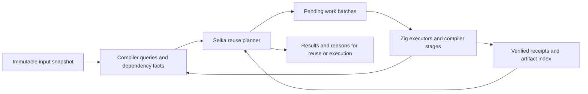

# Selka toolchain caching plan

Status: Wave 1 qualified together with `main` at `e9011d9c6` on 2026-10-10;
integration commit `ed76d2a9c` passed the full gate (83 steps, 2,512 executed
Zig tests) and all 88 Guardian checks. The expanded shadow qualification passed
123 matrix invocations, warning parity and concurrent-edit rejection.
Original Wave 2 (`646b92789`) delivers canonical producer facts, generation-bound
graph metadata, a Selka v2 incremental planner and unaffected test-key reuse.
Its 318 benchmark/oracle invocations passed, but measured edit medians were about
1–39% slower despite substantial fact reuse. Those measurements describe the
original implementation, not the subsequent optimization.

The completed follow-up correctness pass commits shared checked-catalog hashing,
verified planner-byte reuse and plain-root selection work as `07927a094`.
It passed 104 gate steps, 2,550 executed tests, 198 Debug/raw and ReleaseFast/zlib
shadow calls, 40 focused tests and 88 whole-tree Guardian commit-hook checks.
Only the before-change profile ran. At the user's request, paired measurements
and the optimized after-profile were deferred after the benchmark never acquired
admission behind another worktree's gate. No optimization speedup, memory gain or
shorter lock duration is established. Those measurements remain deferred.
The user subsequently authorized integration of current main and cache Wave 3.
Committed main `5174fd03f` (FIFO admission and optimized-debug default) was merged
as `0d9ababf7`; the focused merge qualification passed. These cache waves remain
on the feature branch.
See the [original Wave 2 evidence](../../experiments/cache-wave2-20261010/REPORT.md)
and [completed optimization correctness pass](../../experiments/cache-wave2-performance-20261010/REPORT.md).

## Objective and contract

After a cold qualification, reuse every completed deterministic computation
whose complete inputs and execution contract are unchanged, for as long as its
evidence remains available. After an edit, execute only the requested work whose
dependencies changed, stopping propagation when recomputation produces the same
observable result. Share that evidence across commands and compatible worktrees.

This applies to compiler stages, native artifacts, tests, property cases, fuzz
campaigns, static checks, documentation and performance workloads. It should also
provide the eventual foundation for application-level memoization and incremental
queries from the old Weft design, and for explicit durable application steps
that recover from committed progress after a crash. Durable execution shares
the computation model and artifacts, with stronger retention and effect rules.

“Only edited code” means the affected dependency closure. A callee can change a
test's answer without changing its caller's machine code. Inlining, constants,
layouts, effect summaries and code-generation assumptions can require unchanged
callers to be recompiled. A parser or runtime edit can legitimately affect most
of a compiler's qualification suite. Exact minimal behavioral impact is not a
general computable guarantee; sound, fine-grained dependency tracking is the goal.

Fuzzing has completed campaigns, not a permanent proof that code is bug-free.
Wall-clock measurements are observations under a measurement context, not pure
function results. Live external services require fresh observations. These
distinctions belong in the result model, rather than appearing as exceptions to
an unconditional “everything passed” cache.

## Server admission and lock duration — priority added during qualification

Minimize serialized server occupancy as well as command latency. Record queue
wait, total request-to-result time, build-slot occupancy, gate-lock occupancy and
exclusive performance-measurement occupancy separately. Overlapping slot times
are resource usage, not elapsed wall time. A planner microbenchmark or fewer
canonical digests is insufficient if the admitted command holds its lock longer.

The current `scripts/build-slot.sh` holds a build/gate slot around the complete
wrapped command. The first priority after Wave 2 qualification is to measure
which admitted actions actually execute, which replay and which dominate lock
occupancy. The gate already reuses many results; do not assume every step runs
on every request. Address the observed obsolete-generation catalog scanning and
conservative directory-discovery transitions alongside action-level reuse.

Wave 3 should decide the required action inventory and validate reusable receipts
before expensive admission wherever practical. Prepare immutable inputs outside
the scarce resource window, then revalidate the source, tool, environment and
configuration snapshot when admitted and before publishing success. An edit
while queued must restart invalidated planning; it cannot inherit an old pass.
Split execution into dependency-ordered admitted actions, preserving existing
memory limits and every required gate check. Shorter per-action holds must not
increase total occupied time through redundant preparation or repeated builds.

Performance setup, fixture generation, receipt lookup and result formatting can
normally precede or follow measurement admission. Preserve exclusive access for
the actual measured operation and the environmental stabilization it requires.
A compiler-build benchmark must still isolate the measured build itself; moving
that work outside the lock would invalidate the experiment. Determining whether
an old performance observation is admissible remains Wave 5's context contract.

Before starting broader coverage, establish cold, unchanged, private-edit,
shared-dependency, test-addition and documentation-only baselines in lock-held
seconds. Prioritize removing expensive unnecessary actions over optimizing
already cheap graph operations. Wave 2's observed metadata/planning overhead
means it is a correctness foundation, not yet evidence of shorter server locks.

## Main review before integration — 2026-10-10

Reviewed committed `main` at
`e9011d9c6513f63ae02881d0cfc8258c668e6b5e`, using the clean checkout at
`/home/epentland/ai/canopy/mylang-debug-speedup-main`. There are 114 commits
reachable from this revision beyond the original shared baseline `ef6e0144f`.
The reviewed Wave 1 implementation is `c3107e4cf`; neither it nor its self-hosting
foundation `c2eea010b` is an ancestor of reviewed `main`. The original baseline
and Wave 1 measurements below remain historical evidence, not current-main
measurements.

### What is already implemented

| Main changes | Effect on this plan |
| --- | --- |
| Packed stage storage and source relocation proofs (`b363bcd0b`, integrated by `2c1167c99`) | Use the existing `stage_store` / `stage_pack` backend. Packing is no longer an unqualified dependency or a new Wave 2 deliverable. |
| Recursive return/field summary receipts, post-fusion checkpoints, exact helper-request ordering, narrower raw source-prefix guards and validated generic instances (`72f16706a`, `aff944405`) | Preserve these guards and expose their existing evidence through adapters. Do not build a second optimizer invalidation system. |
| Portable checked-body type recipes, external source proofs, more omitted typed bodies and direct replay into final arrays (`9a77dc754`) | Preserve `semantic-cache-v6`, current-slot contract checks and conservative nominal-type misses. General nominal reconstruction is separate frontend work. |
| Warning-preserving test report replay and allocation diagnostics | Reuse includes observable warnings. Combine this with Wave 1's planner identity and cache explanations in every replay path. |
| Live `.my` formatting, allocation-contract lint and embedded-migration gate steps | Preserve these when integrating the component build and test steps; qualify component sources against the current formatting corpus and the qualified seed. |

The pinned Zig is still `0.17.0-dev.1683+5ceec001b`. Keep the existing component
build and sealed-launch workarounds; this review supplies no reason to replace
the pin or to remove them.

The latest retained evidence is
`experiments/frontend-demand-20261010/{README.md,summary.json,validation.json}`
on `main`, supplemented by `experiments/incremental-gap-20261010/README.md`.
For a helper edit at 510,436 lines, the latest candidate reports 100 freshly
checked bodies, 4,751 replayed typed bodies, 32,850 omitted typed bodies, 30 raw
IR materializations and 44 final IR materializations. It compiles one native
unit. Median wall time is 4.880 s and peak process RSS 1.639 GiB; frontend time
is 3.266 s. These are three-sample, populated-cache reachable-EDA-replica results
with compression explicitly disabled, not cold-build results or a guarantee for
arbitrary applications. The default pack compression is still zlib.

That evidence records 97/97 gate steps, 2,475 executed tests and all 88 Guardian
checks passing. This review inspected the committed code and evidence; it did
not rerun those gates. Earlier compressed-cache measurements of about 1 GiB and
42k files at 510k lines supersede the old loose-cache motivation, but are not a
new capacity measurement of `e9011d9c6` after revision history has accumulated.

### What still needs Wave 2

`src/core/test_runner.zig:sharedKeys` still calls `buildRootsSource` and
`test_runner_identity.Shared.build` after a report replay miss. The latter
digests all functions in that lowering, then walks reachable calls/references
for each test. Current build-cache improvements do not persist those test-key
facts or eliminate this repeated derivation. The new raw/optimized/emission
receipts are useful producer evidence, not interchangeable test identities:
test keys still bind canonical pre-pass Core, ordered roots, invariant roots,
source locations, schemas, providers and execution settings.

`docs/audits/test-keys-once-plan-2026-10-08.md` on main overlaps this work. Its
proposed `test_runner_union_keys.zig` is absent and per-root key derivation is
still present. Fold its measurement and directory-sharing opportunities into
Wave 2; do not run it as an independent competing key pipeline. Preserve its
warning about root-specific source locators for the synthetic first segment,
and keep post-execution source validation per root.

Global declaration/catalog preparation and effect/origin/mutation validation
still run. Ordinary native units still group source-module functions;
`emit_units.Kind` remains module/generic/helper/entry/program. Nothing in the
new evidence means all work is confined to the edited function.

### Integration prerequisite — completed

A `git merge-tree --write-tree --name-only c3107e4cf e9011d9c6` preview reported
conflicts in exactly `build.zig`, `build_test_inputs.zig` and
`src/core/test_runner.zig`. The subsequent integration commit `ed76d2a9c`
resolves those conflicts and passed the combined full gate and shadow matrix
recorded at the top of this plan.

As a focused compatibility check, all eight `.my` files under
`selfhost/components/{cache_plan,test_index}` pass `fmt --check` with main's
recorded shipping compiler. Its SHA-256 was verified against
`experiments/frontend-demand-20261010/validation.json` before running it. This
checks formatting only; it does not replace combined build/runtime qualification.

Before changing caching behavior, integrate on a separate branch and:

1. Combine both build graphs and fixture declarations, retaining component
   qualification and all new main gate steps. Check live component formatting
   without weakening seed compatibility or the formatting policy.
2. Adapt every test replay wrapper to main's `receipt.Replay { report, warnings }`
   while retaining verified planner binding, directory tickets and explanations.
   Exercise warnings on cold, file-replay and directory-replay paths, including
   a planner-only identity change. Neither diagnostics nor admission checks may
   disappear during conflict resolution.
3. Run the combined full gate and Wave 1's independent component, reference /
   shadow, edit-invalidation, corruption and empty-`PATH` qualifications. Check
   the current frontend demand/recursive-summary/source-proof regressions too.
   Record the resulting commit and component/host identities as the Wave 2
   baseline. Until this passes, readiness is architectural, not an assertion
   that the combined implementation is already qualified.

## Original reviewed baseline

Primary review: `/home/epentland/ai/canopy/mylang-worktrees/codex-frontend-packed-20261010`,
branch `codex/frontend-packed-20261010`, committed HEAD
`ef6e0144fbe507d3b51f5512eec8d3465fd137a3`. The worktree was actively changing
during review, including semantic relocation instrumentation and packed stage
storage. Treat its unfinished changes as integration work, not qualified behavior.
Local `main` was `41ed360fb361c49938488ad111795bad8a726b73` at inspection.

Also reviewed the progressive self-hosting implementation in this worktree and
the earlier [interop plan](selka-zig-interop-plan-2026-10-09.md). Reconcile both
branches with their latest qualified revisions before implementation; this plan
does not propose overwriting either branch or replacing its caches.

### Wave 1 integration and evidence

Implementation branch: `codex/selka-cache-wave1-incremental`, in
`/home/epentland/.codex/worktrees/selka-selfhost-wave1/mylang`.
Its starting point is the exact committed incremental revision
`ef6e0144fbe507d3b51f5512eec8d3465fd137a3` plus the self-hosting foundation
commit `c2eea010b`. This does not incorporate the active worktree's unfinished
packed-cache changes or merge later main optimizer changes that would need
their own incremental-cache qualification. Both original working trees were
left untouched.

The native coordinator now independently builds `test-index` and `cache-plan`
with the existing qualified seed. Zig still owns canonical IR, complete call
and function-reference extraction, receipt eligibility and publication. Selka
owns batched reachable-function traversal. Reference, shadow and component
modes preserve the existing ordered-root and sorted-nonroot hash contribution.
Verified planner identity participates before every test replay path, including
directory tickets and whole reports. The existing `--json` test report carries
per-test cache actions and reasons. See the exact
[wire and identity contract](../tooling/component-protocol.md#core-cache-planner-v1).

This implementation uses disposable successful-test evidence. The explicit
policy contract rejects durable retention, checkpoint commit, run/step
occurrences and effect replay. It does not implement application recovery,
new compiler query storage, fuzz scheduling or performance-result reuse.

Focused qualification completed during implementation:

| Check | Evidence |
| --- | --- |
| Selka pure traversal and codec | 7 tests passed at debug and release, with fact verification and leak checking |
| Native protocol oracle | 102 independent graphs plus malformed-frame, unsupported-policy, missing-file, output-failure and aggregate-work-limit checks passed for debug and release components |
| Core edit behavior | Cold run executes; unchanged rerun executes zero tests; helper, callback-target and constant edits preserve unrelated receipts; newly discovered tests execute |
| Planner generation | Behavior-preserving binary identity change invalidates warm file/directory evidence; missing/corrupt manifests and failed component execution refuse reuse |
| Host boundary | Repeated roots, equal digests, cycles, malformed replies, mode identity, deployment changes, timeout and forced process reaping are covered |
| Coordinator | 18 blackbox cases passed, including independent source invalidation, corrupted artifacts, failed planner compilation, unchanged selected manifests on that failure, and isolation from caller Zig global caches |
| Sealed launch integration | 26/26 focused build steps and 14 selected Zig tests passed; 1,534 language, 140 value-semantics and 98 ported tests each passed at debug and release with fact verification and leak checking on the release runs |

Final `zig build test fmt-check -j3 --maxrss 8589934592 --summary all`, through
the shared gate slot, passed all 100 steps and 2,336 Zig tests. The 21,491 skip
entries in the build summary are tests outside each shard's selection. The gate
also passed the language, native protocol, coordinator, Python tooling and
documentation suites, including the real empty-`PATH` component rebuild. Its warm
Debug language run reported 1,534 cached, zero executed and zero failed tests.
Guardian passed all 88 checks without policy or baseline changes. Local evidence
is retained under `.mylang-cache/cache-wave1-validation/`, particularly
`full-gate-sealed.log`, `sealed-snapshot-qualification.log` and the explicitly
transcript-derived `component-qualification.txt`.

The native transport sample, before the bootstrap cache isolation fix, used
the debug planner on reserved CPU 10 with
1,000 nodes, 10,000 edges and 100 root batches. Across five runs, process launch,
planning and captured output took a median 33.891 ms (32.510–34.351 ms), with a
76,884-byte request and 400,068-byte reply. This excludes request construction,
host manifest validation and private executable copying, so it is not an
end-to-end test-command measurement or a comparison with the Zig reference.
A port alone is not a speedup claim. Persisted dependency summaries and reduced
planning work belong to Wave 2.

Full-gate bootstrap qualification exposed a reproducibility dependency on the
caller's shared Zig global cache: cached libc startup objects retained historic
working directories in DWARF. The captured mismatch had identical `.text` but
different debug sections. Fresh component builds now use their own deterministic
Zig global cache, and their identity includes the resolved component store root.
Both components reproduced byte-for-byte under empty `PATH` with a different
caller global cache. Building both components from fresh staging took 17.65 s;
the uncached verification took 16.96 s. These are unreserved shared-machine
observations, include the qualified-seed check, and are not performance gates.

Concurrent language-suite qualification also exposed Linux `ETXTBSY` when a
sibling fork briefly inherited the writable descriptor of a private executable
copy. Stage-specific diagnostics confirmed `FileBusy` at child spawn. Planner
launch now uses a verified, sealed memory-file snapshot whose descriptor remains
alive through child completion, preventing that inherited-writer race without
retrying failed process creation or weakening artifact verification.

At the original baseline, the incremental and self-hosting worktrees contained:

| Area | Existing implementation | Remaining opportunity |
| --- | --- | --- |
| Frontend | Syntax, verdict, checked-body, specialization and summary reuse; stable declaration identities; dependency and record-shape guards | Reduce global metadata work and body restoration; publish compact dependency facts for other consumers |
| Core | Lowering artifacts, optimizer checkpoints/final metadata, demand-loaded bodies and LLVM receipts | Expose these as queries without materializing unchanged bodies to prove reuse |
| Native builds | Content-keyed units, linked programs and whole-build replay; per-user object sharing | Debug/optimized-debug units are still modules, specializations or helpers; Release is a whole-program unit |
| Guest tests | Per-test reachable-IR success receipts, whole-file/report replay, deterministic capability stand-ins and property seeds | Persist reusable dependency metadata; avoid rebuilding all test identities after a small edit; share receipts across compatible worktrees |
| Compiler's own tests | Zig build caches shards using binary, fixture manifests and environment inputs | Many dependencies remain broad; a new compiler binary invalidates many test actions |
| Performance | Native Juice build cache, immutable measurements, input/oracle identities and comparison checks | Select affected workloads and reuse compatible evidence automatically |
| Self-hosting | Independently built Selka test-index component, verified manifest and bounded protocol | That component is informational; it does not authorize test skipping |

Important integration locations from that baseline (also use the newer
`lowering_demand.zig`, `demand_sources.zig`, `optimizer_shortcut.zig` and
`stage_pack*.zig` on current main):

- `src/incremental.zig`, `semantic_cache.zig`, `semantic_copy.zig`,
  `cache_key.zig`, `dependency_report.zig` and `function_identity.zig`.
- `src/core/stage_store.zig`, `lowering_cache.zig`, `optimization_cache.zig`,
  `emission_cache.zig`, `emit_units.zig`, `unit_cache.zig` and `build_replay.zig`.
- `src/core/test_runner_identity.zig`, `test_runner_receipt.zig`,
  `test_runner.zig`, `test_runner_directory.zig` and `test_runner_affected.zig`.
- `src/core/juice/{engine,manifest,collectors,report,inventory}.zig`,
  `build.zig`, `build_test_inputs.zig`, `scripts/affected_tests.py` and
  `src/doctest_command.zig`.

Two distinctions must survive the integration:

1. `tests_index.callGraph` deliberately omits unresolved function-value calls.
   It is unsuitable as the authority for skipping tests. The Core receipt graph
   includes calls and function references, with a conservative fallback when
   metadata cannot be represented.
2. The compiler's existing counters separate work performed from artifacts
   restored. The retained checkpoint experiment reports 1/1/3 fresh lowering,
   optimization and native-unit compilations for entry/helper/three-file edits,
   while still materializing substantially more bodies. A native unit is not
   necessarily one function. Preserve that distinction in every claim.

The original retained experiment reports 237,589 files and 3.234 GiB allocated
cache space after a fully cold 510k-line fixture build. This is the historical
loose-cache baseline, superseded by the packed-storage evidence discussed above.
See its `experiments/checkpoint-reuse-20261009/README.md` and
`experiments/demand-artifacts-20261009/README.md` for methods and limitations.

## Architecture: one dependency model, several result contracts

Use a shared query/action protocol over existing stores. Migrate producers one
at a time. A unified model does not require one physical file format or identical
policies for native objects, test receipts and performance records.



### Identities and dependency facets

Keep a stable logical ID separate from a content digest. Inserting a declaration
must not rename unrelated queries. Use package/module/declaration identities,
specialization arguments and operation kinds; never durable arena ordinals.

Give dependencies the facet a consumer actually reads:

| Facet | Typical readers | Example invalidation |
| --- | --- | --- |
| Signature and public contract | Type checking callers | Parameter type, effect ceiling or visibility changes |
| Body / normalized checked IR | Lowering and execution closures | Implementation changes |
| Layout, constants and embedded assets | Layout consumers, constant evaluation and code generation | Field layout or embedded file contents change |
| Inferred effects, mutation, ownership and parameter facts | Global checking and optimization | A callee gains an effect or an optimization assumption changes |
| Optimized body and consumed optimization summaries | Inlining and other dependent transforms | An inlined callee changes |
| Debug positions and observable source metadata | Diagnostics, debug objects, stack traces and snapshots | A reached source location moves |
| Discovery and resolution | Test/module inventories, name lookup and indirect targets | A test is added, an import changes, or an absent name becomes present |
| Execution inputs | Test/fuzz/performance actions | Fixture, provider, generator, seed, oracle or runtime changes |

Do not make an ordinary caller's object depend on every callee body. Do make its
test execution depend on the implementations it can reach. Record negative name
lookups, missing files, directory/glob membership and possible indirect target
sets. Revalidate discovery so new tests and newly reachable code cannot disappear
behind an old successful report.

Recursion needs strongly connected dependency groups. Propagate effect and other
recursive summaries to a fixed point within a group, then publish its result.
Unexpected query cycles should be diagnosed, not mistaken for cache hits.

Separate semantic and source-position identities only where their observability
is understood. Current test keys include source positions; keep that behavior
initially. A comment edit can avoid semantic work while still requiring new
debug information or diagnostics. Never replay a stale source location to gain
a prettier reuse count.

### Query and action receipts

A conceptual receipt contains:

```text
logical ID, operation kind, schema version
producer implementation and execution contract
ordered dependency reads with facet and observed fingerprint
output fingerprint and referenced artifact digests
eligibility, completion status and evidence kind
reuse/retry policy and retention/durability contract
run and step occurrence identity when scoped to a durable execution
```

The lookup identity binds the operation, canonical arguments, producer and
relevant target/tool/runtime/flags/provider settings. Before admitting a previous
result, validate its dependency reads against the current snapshot. A changed
control dependency requires recomputation before following obsolete dependent
reads. Replace the dependency set after recomputation, including removed reads.

Compare output fingerprints to stop propagation when the result is unchanged.
Equality must include all downstream-observable output, including relevant
diagnostics and metadata. Keep artifact contents in the store and compact hashes
in the graph; do not load a whole typed body just to discover that it is reusable.
This follows the established demand-driven, red/green query approach described
in the [Rust compiler guide](https://rustc-dev-guide.rust-lang.org/queries/incremental-compilation-in-detail.html).

Classify results explicitly:

- **Deterministic result:** reusable while every input and contract is unchanged.
- **Completed exploration:** a particular property/fuzz seed range or campaign
  was completed; only that evidence is reusable.
- **Measurement:** observations under a collector, environment and sampling
  policy; a request for fresh timing still executes.
- **Live effect:** external state is untracked; execute when the gate requires it.
- **Recorded effect:** an outcome retained for one durable execution step;
  replay it within that run under its recovery contract. It is not a globally
  reusable result for every invocation with the same arguments.

Store failures as diagnostic evidence if useful, but retain the current initial
admission rule: only complete successes satisfy a test gate. Timeout, cancellation,
refusal, flaky retries, partial batches and corrupt records never become passes.
An incomplete action can contribute independently completed child cases.

### Requirements for future durable applications

Keep the implementation waves below. Wave 1 should specify these boundaries so
the eventual durable runtime can use the same foundation. It does not need to
implement a workflow engine or journal effectful applications yet.

1. **Separate computation identity from execution identity.** A pure chunk
   transform can share a result across runs by code, input and settings. A
   durable operation also has a run ID and a stable step/occurrence ID, including
   repeated loop items. Two intentionally distinct writes with identical
   arguments remain distinct operations. Retries of one operation keep the same
   idempotency identity; an attempt number must not turn a retry into a new effect.
2. **Separate disposable results from retained recovery state.** Cache artifacts
   may be evicted. A durable run pins its journal, captured inputs, code version
   and state needed for recovery until explicit completion/release or the
   configured retention policy permits deletion. Suspended runs survive process
   leases expiring. Storage limits must produce backpressure or an explicit
   failure rather than silently delete required history.
3. **Define a durable commit boundary.** Persist and validate a step's output
   before committing a journal record that references it, and acknowledge the
   checkpoint only after the configured durability guarantee is met. For local
   power-loss recovery, that includes the required data and filesystem metadata
   flushes; atomic rename alone is not the durability contract. Torn or partial
   records are never completed checkpoints. Group commits can bound overhead,
   with the possible repeated work stated explicitly.
4. **Declare replay and retry behavior.** Pure unfinished work may run again.
   Clock/random/external-read results need recorded values or immutable snapshots.
   External writes need a transaction, an idempotency protocol or reconciliation
   with the destination. A crash after a write but before its acknowledgement
   leaves an uncertain outcome; losing its receipt does not authorize blindly
   repeating it. Require adapters for untracked Host/FFI operations.
5. **Version the run and its state.** Retain executable/implementation identities,
   step schemas and serialization versions. Resume against the original code and
   captured inputs, or use an explicit migration. A new run under edited code may
   reuse compatible pure artifacts, but cannot silently reinterpret an existing
   effect history. Store serializable state or artifact references, not process
   pointers, file handles or transient planner handles.

Expose separate cache-publication and durable-commit capabilities over any shared
store implementation. Existing best-effort cache publication cannot claim durable
completion. Missing recovery history is an explicit recovery failure unless the
operation's contract establishes a safe reconstruction. Concurrent recovery needs
exclusive ownership or fencing so a stale worker cannot commit another effect.

This supports a future CSV job with an immutable source, stable chunk identities,
committed chunk outputs and aggregation state, followed by recoverable publication
of the final file. It resumes at committed steps; it does not require restoring
an arbitrary native stack or checkpointing every function call.

### Selka ownership and Zig ownership

Extend progressive self-hosting with a `cache_plan` component, separate from the
informational test index. Selka initially owns pure graph operations, affected
closure calculation, receipt planning and explanations. Zig owns source/Core
fact extraction, canonical hashing, filesystem access, process execution,
resource limits, artifact validation and atomic publication.

Use one bounded batch exchange per planning operation, not one subprocess per
function. Keep large IR and AST values in their existing stores. The next step
can be a persistent Selka planner with session-scoped handles and revision tokens
if measurements justify it. An in-process ABI is not required to start.

The planner receives immutable snapshots and returns work IDs. Accept completion
only for the same pending work, snapshot and producer identity. A new edit cannot
publish a stale completion as the current result. Deduplicate concurrent requests
for the same reusable computation or the same durable step occurrence, according
to its policy. Cancellation and worker failure release transient claims; they do
not release durable history or establish that an external effect did not occur.

Every early replay path must bind the verified planner implementation before it
can return a result: directory/report replay, tool tickets, whole-file receipts,
per-test receipts and, when integrated, compiler build replay. Updating only a
final key would leave old fast paths incorrectly eligible.

Keep the qualified seed and independent component build arrangement. Bootstrap
must not require the planner it is building. Component qualification and the
reference/shadow oracle need an execution path that cannot be satisfied by the
component's own unverified skip decisions.

## Implementation waves

### Wave 1 — Establish the reuse contract and self-host Core traversal

Implemented and qualified with reviewed main in `ed76d2a9c`. It creates the
extension point used below; the integration evidence supersedes the original
branch-only qualification for this main revision.

1. Pin the latest qualified incremental and self-hosting revisions on an
   integration branch. Record baseline work counts and current cache admission.
2. Specify operation/receipt identities, graph completeness, snapshot ownership
   and reasons for reuse/miss. Add a machine-readable planning/explanation report;
   exact CLI spelling can follow the existing work-report conventions. Define the
   future run/step identity, retention, commit and retry-policy boundaries above;
   ordinary compiler caches remain disposable, and unsupported durable contracts
   must be rejected rather than approximated by best-effort caching.
3. Port `test_runner_identity.Shared.reach` into the new Selka component.
   Preserve ordered root contributions, sorted non-root digests and multiplicity;
   keep Core canonicalization and `.call`/`.func_ref` extraction in Zig.
4. Add component identity to all test replay paths before enabling its decisions.
   Preserve the existing per-test fallback, property/invariant roots, source
   providers, host restrictions and unknown-metadata behavior.
5. Qualify in reference and shadow modes, then enable the component for the
   existing receipt traversal. A failed or invalid component must never mean
   “nothing affected”; retain explicit reference execution for recovery.

Deliver as three reviewable changes: contract/reporting; component plus shadow
parity and identity wiring; production integration plus the edit qualification
matrix. A port alone is not claimed as a speedup; measure its transport cost.

Exit: identical unedited deterministic suites execute zero tests; editing a
helper reruns its dependent tests and reuses unrelated receipts; callback,
constant, provider, discovery, planner-only and corrupt-cache changes behave
correctly. A component edit rebuilds independently of the Zig host.

### Wave 2 — Persist validated dependency facts and reuse test-key derivation

Implemented against the qualified integration above. The following describes
the delivered contract; the qualification report records the precise limits.
The original measurements regressed; optimization `07927a094` is correctness
qualified, with paired timing and its after-profile deferred at the user's request.
Metadata is namespaced by source path, graph batches are still validated in full,
and exact retained keys stand in for recomputing unaffected closures. Global
semantic checks and conservative discovery/source guards remain active. The
independent eager reference path remains available for qualification.

**2A. Publish compact producer facts.** Add records while frontend/lowering
already performs its required work, or when an existing validated receipt
provides complete evidence. Start with canonical pre-pass function digests,
complete `.call` / `.func_ref` edges, stable declaration/specialization/helper
identities, source provenance and the input facets that authorize their reuse.
Represent untracked or ambiguous metadata explicitly and take the existing
complete-lowering fallback. Optimized outgoing edges or an informational
source call graph cannot substitute for the pre-pass test graph.

Adapt existing semantic summaries, lowering-demand receipts and Core headers;
do not replace the stores or infer validity just from unchanged body text.
Keep full compiler identity, relevant target/options/provider contracts and
schema identity. Remap persisted logical identities to current snapshot-local
IDs only after validating discovery. Position-sensitive canonical digests must
reflect current source locations, including directory-root locator differences.

Store these records through the existing packed backend under distinct logical
schemas. Keep metadata independently addressable from body payloads, split
oversized metadata collections and measure block read/decode amplification.
Current packing groups small records and can still decode neighboring records;
do not claim arbitrary hits read only the requested bytes. Preserve checksum,
corruption, concurrent-reader and publication guarantees. Streaming hashing is
a targeted follow-up where measured full-artifact allocation remains, not a
rewrite of the new packing layer or its serialization contracts.

**2B. Persist the graph and affected test summaries.** Retain generation-bound
forward/reverse edges and test-root closure summaries. Publish a coherent graph
revision only after its facts validate; a reverse index alone is not reuse
authority. Additions, removals, changed indirect targets and negative discovery
results update the graph before a suite can be admitted. Replace obsolete
dependency reads rather than accumulating them forever.

Selka owns graph planning and closure reuse; Zig continues to extract and
validate facts, hash canonical values, access storage and execute work. Use
recursive groups to share closure work, handling both cycle creation and cycle
splitting. Preserve ordered root contributions, repeated roots, distinct nodes
with equal digests and sorted non-root digest multiplicity. Group fingerprints
may index the work but cannot silently change the legacy key contribution.
Stop downstream propagation only when every observed facet remains equal.

Do not resend or serialize the complete graph for every test. Measure one
bounded batch per affected planning operation and share immutable records
across directory roots where valid. Wave 1's 16 MiB request, 64 MiB reply and
16-million traversal-work bounds are not an incremental graph protocol. If
new operations or revision handles are needed, version and qualify the protocol
and all early replay identities explicitly. First use persisted records with
one-shot processes; a resident planner is optional and requires measurement.

**2C. Consume facts in the guest test runner.** After a source edit, derive
unchanged eligible test keys from validated metadata instead of lowering and
digesting their entire reachable program again. Lower changed or unsupported
parts conservatively. Keep the canonical test-key contribution bit-identical
under the same planner identity, source snapshot and execution contract; any
deliberate component/schema identity change still invalidates prior evidence.
Retain the current full-lowering key path as an independent oracle in shadow
qualification, with the new metadata reuse disabled in that oracle.

Measure the directory runner before introducing shared union lowering, schemas
or source digests from the older TK proposal. Share only work the measurements
justify, account for root-specific source positions, and preserve each root's
post-execution input checks. Cover both shared-directory and single-file paths,
providers, generated-parameter invariants, unknown-metadata fallback, warnings
and whole-report replay. A metadata miss recomputes; malformed or failed planner
execution keeps Wave 1's explicit error/reference-recovery behavior.

**Stopping point and qualification.** End this wave when a selected set of
eligible edits reuses unaffected tests' canonical facts and closure summaries,
and the independent oracle produces identical keys and verdicts. Do not require
conversion of every compiler analysis into queries before delivering this win.
Global effect, mutation, origin, allocation and resolution validation continues
to run until a later change gives each a complete, independently qualified
invalidation contract. Retain current conservative type and source-proof misses.

Use the integrated baseline for cold, identical rerun, first private edit, shared
callee edit, comment/source movement, signature/layout/effect/embed changes,
callback/recursive-edge changes, test addition/deletion, revert, corrupt/evicted
metadata and concurrent-edit comparisons. Include a previously passing test made
failing by a transitive edit. Run reference/shadow differentials and independent
forced execution, then the full gate. Packed zlib and raw encodings must agree;
benchmark the default encoding as well as any diagnostic policy used for comparison.

Report key-derivation CPU and wall time, canonical digests computed, graph records
visited/reused, reverse-index work, transport bytes/startups, bodies restored,
bytes hashed/read/decoded, tests executed, native units, link work, peak memory
and retained cache growth. Use directory workloads plus the existing 191k/510k
fixtures. For independent additions, eligible key/closure recomputation should
follow the affected closure rather than total program size; measure remaining
source validation, pack indexing and global frontend work separately. Require
work-count and end-to-end evidence, not just zero test executions or a planner
microbenchmark. Preserve program, warning, trap and debug behavior.

**Separate follow-up: native unit granularity.** Function or small-group native
units remain useful to investigate, with explicit symbol, constant, debug and
linkage ownership. They are outside Wave 2's acceptance criteria and do not
block Wave 3. Compare native process count, linker time, object count, cold and
edit builds and runtime before adopting them. One object per function can make
builds slower. Keep whole-program Release until a separate qualification proves
its intended optimization quality. Do not describe one module unit as one
function recompiled.

### Wave 3 — Cover the entire verification command

The first implementation exports the actual `test`/`fmt-check` graph and exact
native artifact locations from `build_verification.zig`. The developer entry
point `scripts/verify_cache.py` validates preparation and whole-action successes
before requesting FIFO admission. It batches misses/fresh actions into one gate
invocation, preserving the original DAG, shard concurrency and memory limits.
Unknown required nodes, including compile-only additions, force the original
complete gate. Source, fixture, tool, environment and artifact watches remain
active from hashing through queueing and success publication, including ABA and
overflow rejection. Prepared native inputs include the embedded documentation.

The native Zig suites remain whole-executable/cohort evidence. Guest tests keep
the compiler's finer receipts; untracked effects, Guardian/git scope, generated
outputs and explicit fact/leak executions retain freshness boundaries. This
does not infer function dependencies inside Zig test binaries. Receipt lookup
is local to a worktree, and the first adapters conservatively share native/tool
identities; further input partitioning needs separate qualification.

See [the developer command](../tooling/many-agents.md#reuse-verification-evidence-before-admission).
Operational reports record selected/reused/fresh cohorts and admitted seconds.
The isolated edit-matrix performance qualification below remains outstanding;
the previously deferred Wave 2 benchmark has not been restarted.

Prioritize reductions in measured gate/build lock occupancy using the admission
boundary above. Move validated no-work decisions ahead of execution admission;
keep freshness-required checks and complete snapshot validation.

Register adapters for guest tests, compiler Zig tests, CLI/integration tests,
doctests, format/lint checks, generated interfaces, fixture generation and
Guardian checks. Preserve their current commands and success criteria. The
top-level gate inventories all required actions, then satisfies each by a valid
receipt or execution. “Not selected” is distinct from “passed previously”.

Guest tests can use compiler-provided dependency facets. While the compiler is
mostly Zig, its own tests start with exact executable/tool/fixture/command keys
or independently built module/shard keys. Selka cannot infer sound function-level
dependencies inside arbitrary Zig binaries. `scripts/affected_tests.py` is a
useful prioritizer and explicitly not a full gate; do not promote its textual
heuristics into proof that a test can be skipped.

Split broad test input lists only with evidence about everything they read.
Capture C include dependencies, generated headers, libraries and relevant
environment before admitting foreign-code results. Preserve current refusals
for untracked Host/FFI behavior. Isolate tests from shared process/global state,
or make setup, ordering and reset behavior part of the action contract.

Formatting can key by file bytes and formatter. Lint/Guardian global checks
must also key their repository/configuration scope, rules and baselines. Doctest
keys include extracted snippets, expectations, language/compiler and imported
inputs; documentation navigation/rendering remains a separate result.

Existing `--force`, `--verify-facts`, leak-check and rerun controls retain their
meaning. Separately modeled sanitizer/leak/fact-qualification actions may later
reuse their own complete evidence; an ordinary passing test cannot satisfy them.

Exit: an unchanged normal gate launches no cacheable test/check workers, while
still checking its inventory and running actions explicitly requiring freshness.
Fixtures, added/deleted tests, environment, rules and tool changes invalidate the
right actions. A new compiler may still invalidate a broad suite legitimately.
Report lock-held seconds and executed actions for the same edit matrix before
and after; shorter hold per action alone is not sufficient if total occupancy
or end-to-end latency grows.

### Wave 4 — Incremental property testing and fuzzing

Extend the current property runner, whose receipts already include seed and run
count, with stable case ordinals and completed ranges. Key each range by target
closure, generator/shrinker/oracle, provider, instrumentation and input-generation
contract. Increasing a qualified campaign from 1,000 to 2,000 cases should run
only the additional cases when the generator supports stable indexed generation.
Preserve attempted/discarded-input semantics; a run-count change alone is not a
proof that an old prefix matches a new one.

Register compiler differential fuzz drivers as explicit actions too: generator,
reference compiler/oracle, candidate compiler, harness, flags, fixtures and seed
ranges all belong in their identity. A candidate compiler change may invalidate
every prior differential result even when generated source is unchanged.

For coverage-guided fuzzing, persist input corpora, minimized crashes, coverage
schema, engine version, configuration and campaign evidence. Keep independent
target shards. Select targets whose transitive dependencies changed, replay their
retained corpus on the new target, then spend new exploration budget there.
Coverage from an old binary is not proof about the new binary. Deterministic
campaign continuation also needs engine state or explicitly independent seed
shards; a corpus plus an integer seed is not a universal checkpoint.

Use observed coverage to prioritize affected paths, not as the sole authority
for excluding code that a prior input never reached. Retain broader scheduled
exploration to discover untested interactions; ordinary edit gates can reuse
unchanged completed campaigns. This extends, rather than replaces, the corpus
model in [LLVM's libFuzzer documentation](https://llvm.org/docs/LibFuzzer.html).

Exit: unchanged qualified ranges execute zero cases; budget extension executes
only new ranges; edited dependencies replay the relevant corpus and explore
again; cancellation resumes completed ranges without reporting an unfinished
campaign as passed.

### Wave 5 — Incremental performance evidence through Juice

Use Juice's existing workload manifests, immutable records, build identities,
oracles and comparison rules. Add workload-to-code/data dependency manifests
and an automatic evidence lookup. Include harness/setup/teardown, providers,
inputs, output verification and measurement configuration in each workload.

Cache static cost/fact analyses as compiler queries. Cache reproducible counting
runs only within a fully specified execution and instrumentation contract; keep
their raw evidence. Existing Juice instruction counts are a performance proxy,
not a guarantee of elapsed time, and allocation counters retain their documented
allocator-dependent meaning.

An edited helper schedules every benchmark that can execute it, even if the
benchmark body itself is unchanged. A harness that starts directly at the
affected operation can avoid expensive setup; a function-level counter region
alone still executes setup. A previously cold path needs coverage review or a
new workload, not an assumed zero performance impact.

Physical measurements must include relevant executable/link layout, runtime and
library contents, collector/version/events, CPU/OS context and sampling policy.
Unrelated code can move addresses and affect physical performance, so a changed
whole-program binary is not automatically equivalent for native timing. Keep
isolated microbenchmarks for locality and representative end-to-end workloads
for system effects.

Separate reusable measurements from comparison decisions: a changed performance
threshold can re-evaluate old compatible samples; changed instrumentation or a
request for fresh wall-clock timing executes again. Keep periodic whole-system
timing and calibration outside the cheap deterministic edit gate.

Exit: unchanged compatible requests reuse records; edits schedule affected
workloads; threshold-only changes rerun comparison; changed measurement context
never inherits an incompatible result or silently claims a fresh measurement.

### Wave 6 — Sharing, retention and the no-op floor

Share immutable artifacts and eligible action receipts locally across worktrees;
keep mutable source snapshots and revision indexes private to each worktree.
Use workspace-relative logical names and explicit path mappings where semantics
allow them. Absolute paths currently occur in test keys/debug outputs. Do not
strip them blindly: first prove that path-sensitive behavior and diagnostics
remain correct. Reverting to a retained revision should recover its old results.

Support atomic publication, concurrent same-key work, bounded memory/disk,
crash recovery, GC roots/leases and explicit cache format compatibility. A
missing or damaged cache result falls back to work; an invalid configured
component is an error, not a fake cache miss yielding success. Eviction must
never delete a running action's only live input. Same-key differing outputs are
a determinism error to investigate, not last-writer-wins evidence.

For future durable users, GC must also honor persistent run roots independently
of live workers. Keep journal retention and durable commits separate from cache
LRU and best-effort writes. Implement and qualify those stronger capabilities
before the application API offers restart guarantees.

A content digest establishes bytes, not that a claimed action produced those
bytes. For remote reuse, authenticate trusted producers and action-to-output
receipts as well as checking payload integrity. Introduce remote storage only
after local behavior is qualified. Bazel's separation of an action cache and a
[content-addressed store](https://bazel.build/remote/caching) is a useful reference;
[hermetic inputs](https://bazel.build/basics/hermeticity) remain essential.

Then consider a persistent workspace process for validated digests, graph indexes
and batched Selka planning. Watchers and metadata are accelerators, not sole
proof of content. Handle event loss, restart, timestamp-preserving writes and
concurrent edits through rescan/content validation or immutable snapshots.
One-shot commands remain correct without a daemon.

Measure end-to-end no-op time, including directory discovery, tool identity,
hashing, locks, component startup and materialization. Zero test executions does
not imply zero work. Aim for work proportional to changed inputs and demanded
dependency metadata in a warm session; do not promise constant-time validation
of an arbitrary mutable filesystem after process restart.

### Wave 7 — Application caching, durable steps and further self-hosting

Expose a small `incr`/memo library once the internal graph contract is proven.
Start with explicit bounded caches for pure functions and stable immutable
values. Persistent keys include reachable implementation, canonical argument
encoding, result schema and relevant compiler/runtime/target behavior. Higher
order arguments need code and captured-environment identity. Resource handles,
untracked FFI and hidden effects are ineligible.

Add explicit durable steps as a subsequent library milestone. Start with local
data pipelines: captured input, chunk transformations, serializable aggregation
state, a retained run journal and recoverable output-file publication. Let the
author choose checkpoint granularity. Qualify recovery before adding general
effect replay, distributed workers or compiler syntax for durable functions.

The first durable qualification injects crashes before and after artifact writes,
journal commits and final publication. It verifies the same final CSV output as
an uninterrupted run, reuse of committed chunks, safe handling of uncertain
publication, duplicate recovery attempts and rejection of incompatible code or
changed inputs. Exercise retained-state GC, incomplete records and storage
failure as well as normal process restart. State separately whether process-crash
or power-loss durability has been established.

Keep file/network freshness in explicit effect providers. A TTL cache cannot
satisfy an exact build/test dependency unless the dependency contract actually
allows stale data. Filesystem metadata equality alone cannot prove contents are
unchanged, including same-size writes that preserve timestamps. This tightens
the old draft's file-caching sketch for correctness-critical toolchain use.

Self-host additional planners, generators, analyzers and compiler stages one at
a time behind the same protocol. Initially retain the existing whole-compiler
identity for frontend and test evidence. Narrow it only when a producer has a
verified independent implementation identity and complete dependencies. A manual
schema version alone is not enough to keep results across compiler bug fixes.
This is how a tooling-only change can eventually avoid invalidating unrelated
compilation and verification work while the compiler becomes progressively Selka.

## Qualification and observable success

Use a controlled edit matrix against an independent forced execution. Begin
with the current per-test/reference paths and clean compiler builds, then add
random edit sequences. The reference must disable the cache layer being audited.
Current `--no-cache` still permits per-user native object reuse; isolate that
store and relevant tool caches when validating native code generation itself.

| Edit or event | Required outcome |
| --- | --- |
| Identical rerun | Zero eligible test executions and native compilations; unchanged artifacts and results |
| Private helper body edit | Recompute its dependent compilation queries; rerun reachable tests/fuzz targets/performance workloads |
| Same-signature callee edit | Ordinary caller object may survive; dependent execution evidence must be reconsidered |
| Signature/layout/effect/constant/embed change | Invalidate consumers of that facet, including folded values and optimizer assumptions |
| Callback target or implementation-set change | Invalidate affected indirect-call closures; incomplete target knowledge widens the work |
| Add/delete/rename test, module or fixture | Recompute discovery; never accept an obsolete suite inventory |
| Comment or source movement | Preserve eligible semantic work while refreshing observable positions and path-sensitive outputs |
| Seed/generator/provider/oracle change | Recompute affected case/campaign evidence |
| Threshold-only performance change | Re-evaluate compatible evidence without pretending to remeasure |
| Compiler/planner/runtime/toolchain/CPU change | Invalidate according to producer and execution contract; no early replay bypass |
| Revert or compatible second worktree | Reuse retained evidence subject to path and execution contracts |
| Torn/corrupt/evicted cache or interrupted writer | Recompute or report the real tool failure; never return partial success |
| Edit during execution | Publish only to the action's immutable input identity; do not satisfy a newer revision |

Include a regression where a formerly passing cached test becomes failing after
a transitive edit. Test additions, negative lookups and indirect targets deserve
their own cases because successful existing tests cannot reveal omitted work.

Report at least: requested actions; validated/reused/recomputed queries;
metadata visits; bodies decoded; bytes hashed/read/decompressed; native units
compiled; link invocations; tests/cases executed versus reused; fuzz ranges and
corpus replays; fresh versus reused performance evidence; publication and planning
time; peak memory; retained bytes and file count. Explanations should name the
changed dependency and facet, not just “cache miss”.

Keep deterministic work-count assertions in tests. Measure latency and memory
under the repository's build slots and timing isolation, with the same hardware,
cache state and fixtures on both sides. Define numerical latency budgets from
those baselines rather than inventing a universal sub-millisecond target.

Wave 1 has ended at the reuse and future-durability contract boundary. Wave 2
has implemented the persisted-facts and test-key reuse milestone against the
qualified main integration. An application workflow runtime
remains Wave 7: the packed cache's recovery journal is disposable cache storage,
not durable application progress. Wave 2 establishes reusable facts and keys,
but original measurements show metadata/planning overhead and conservative
directory discovery transitions can outweigh saved computation. The subsequent
correctness-qualified optimization is unmeasured; resume its paired comparison
and after-profile before promising a faster edit loop or advancing integration.
Wave 3 extends reuse to the
whole verification command; fuzzing and Juice can then consume its facts.
The later storage, daemon and public memo work should be driven by measured
overhead and reuse, not prerequisites for getting the first safe wins.
