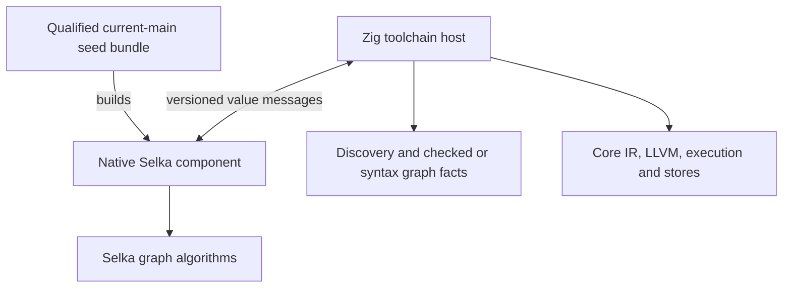

# Selka and Zig interop for progressive self hosting

Status: first wave implemented and locally qualified, 9 October 2026. Reviewed against
local `main` at `0689d3407c17df34915aeb2a92e309af3a04921c`. Milestones 0–2 are
implemented on `codex/selka-selfhost-wave1`; see the
[qualification record](selka-selfhost-wave1-2026-10-09.md) and
[component guide](../tooling/selfhost-components.md). Later milestones remain proposals.

Build separately compiled Selka components behind a versioned value boundary.
Start with the small test reachability index used by `mylang tests-for`, lint
notes and interface reports. Then qualify a separate operation for the current
Core test-cache dependency traversal, followed by persistent query management
and larger compiler stages. A component implementation edit should rebuild that
component and its tests without rebuilding the Zig compiler executable.

The original version used the older `local-reasoning/integration` checkout. Its
implementation inventory was obsolete: main has completed the new-core transition
and the readable frontend redesign. This revision replaces those integration
points. Source paths and line numbers below name the reviewed main commit, not
files in the older working tree where this plan is currently saved. Inspect an
exact source with `git show 0689d3407:path/to/file`.

## Corrections from the main review

| Earlier assumption | Main at the reviewed commit | Consequence |
| --- | --- | --- |
| Native components use QBE and its runtime | Core IR emits LLVM, compiled by the pinned Zig toolchain; memory uses one-count reference counting and copy-on-write | Build components with the current debug path. Do not pass `--backend qbe`. |
| Shared libraries and registered host providers are available | `--library`, `--provider`, `invoke`, host functions and the old embedding/provider headers were retired | Process interop is the first supported route. An in-process bridge would be new backend/runtime work. |
| Port `src/native_test_plan.zig` | That file is absent. Tests use `src/core/test_runner*.zig`, Core IR identities and layered replay | Start with informational reachability; integrate cache traversal separately with the current runner. |
| The syntax redesign is pending | `func`, explicit `const`/`mut`, block scope, `T[]`, optional suffixes and failure syntax have landed | Write components for a qualified current-main seed, not the old source subset by assumption. |
| The old seed and component build cache can be reused unchanged | The pin still names an old QBE compiler. The live lexer harness uses `--compiler`, adapts temporary source and builds a temporary executable | Reuse verification ideas and fixtures; establish a new complete seed bundle and component manifest. |
| A parser wire codec already provides the boundary | `src/syntax_table.zig` is absent | A current syntax interchange format is later work, not an existing prerequisite. |
| Test caching is the old manifest/purity scheme | The current runner hashes reached Core IR with BLAKE3, has source-provider groups and early report replay; `--pure-skip` is retired | Preserve current identities, eligibility and replay rules. |

The architecture remains useful: a pinned native compiler can build Selka
components that the Zig toolchain invokes. The first migration and its transport
must fit the current implementation.

## Current foundation

`src/main.zig` dispatches build/run/test through `src/core/cli.zig`. The public
tool is `mylang`; Core is integrated into it. A checked program becomes Core IR,
then LLVM text, then a Linux x86-64 executable linked with the Core C runtime and
native helpers. Debug builds emit/cache module units; release builds emit a
whole-program unit. Qualify other targets separately.

Current C interop is Selka-to-C scalar `extern func` with a leading `Host`
capability and `--link FILE.c`. It does not provide arbitrary buffer/record
arguments, Zig-object linking, exported Selka library functions, or callbacks.
Tests receive no `Host`, and a run with `--link` cannot reuse test results.
A foreign-call shim is not the default component boundary.

Supported I/O is enough for a first batch component: read a bounded request file
through `Filesystem`, write reply bytes with `Stream.write`, and send diagnostics
to the separate error stream. General binary stdin reads are not an established
public Selka capability in this review. The Zig host already has process/pipe
support in `src/core/process_spawn.zig`; that does not itself provide the Selka
side of a persistent worker.

## Architecture and ownership

Keep the algorithm in an ordinary Selka library module, with a separate native
entry adapter. Language tests exercise the library directly; Zig integration
tests exercise transport, command behavior and failures.

| Responsibility | Initial owner |
| --- | --- |
| Parsing, checking, discovery, graph extraction and diagnostic source ownership | Existing Zig frontend |
| Inverting an explicit call graph into related-test answers | First Selka component |
| Core IR canonicalization, test execution, eligibility and receipt publication | Existing Zig Core runner |
| File snapshots, hashing, process control, atomic publication and locking | Native host |
| Revisions, recorded query dependencies and early cutoff | Later Selka query engine |

Compiler trees and managed objects stay behind the boundary. The host passes
explicit data and later executes named work requests; the component does not
need to understand Zig allocators or implement the whole type checker.

## First component and production integration

Port `src/tests_index.zig:118`, `buildNamed`. The file is 161 lines at the reviewed
commit; the core algorithm is about 40 lines. It is shared by checked and
syntax-based navigation, lint and interface reports. This makes a real toolchain
command partly self-hosted without immediately controlling whether a test executes.

A `test-index-v1` request contains a snapshot ID, an ordered function-name table,
adjacency lists using snapshot-local integer indices, and test indices in discovery
order. Its response contains per-function direct and transitive test-index lists.
Zig maps these into the existing owned `Index` and retains report formatting.

Preserve ordering, self-reachability, cycles and direct-edge multiplicity. Do not
silently deduplicate output during the port. Reject out-of-range indices and
inconsistent table sizes at the boundary. Names and table identities belong to
the snapshot; integer indices are not persistent identities.

Keep `discoveredTests`, `callGraph`, syntax graph extraction and formatting in
Zig initially. Route checked navigation through `src/navigation.zig`, syntax
fallback through `src/navigation_syntax.zig`, lint through `src/lint.zig`, and
interface reports through `src/interfaces.zig`. Pass an explicit adapter at
command boundaries. The pure library function currently takes only an allocator
and values; do not hide process launches or filesystem access inside that signature.

Compare Selka and Zig on the same graph in shadow mode. After parity and
performance qualification, switch all production consumers. Keep Zig as an
explicit bootstrap/reference path during the transition, then freeze or remove
its production use. Missing components, invalid replies and traps are component
failures, never empty answers.

### Informational graphs and cache dependencies

`tests_index.callGraph` records direct checked `.call` edges and deliberately
excludes unresolved function-value `invoke` sites. Its syntax fallback is labeled
as syntax-derived information. Neither graph replaces the test runner's complete
execution-dependency identity.

A later, separate cache-related port targets
`src/core/test_runner_identity.zig:44`, `Shared.reach`. Zig retains Core IR
canonicalization and `.call`/`.func_ref` edge extraction, sends the complete graph
plus digests and ordered roots, and hashes Selka's canonical traversal result
using the existing BLAKE3 encoding. Preserve ordered root contributions, sorted
non-root digests and duplicate-digest multiplicity. Do not substitute the
informational graph or its output order.

Retain the current per-test fallback for `UnknownMetadata`, source-provider
groups, property/invariant roots, execution settings and refusal behavior.
`src/core/test_runner_affected.zig` remains its own selection policy: untraced or
deleted declarations and constants can retain every test, and unsupported Core
builds remain selected so their refusal is reported. Moving an algorithm must
not narrow these conservative cases.

## Value contract and initial transport

Define `component-protocol-v1` separately from each operation schema and component
implementation identity. The envelope carries protocol/schema version, component
kind, request ID, snapshot/revision ID, operation tag and payload length. The host
verifies the selected artifact manifest and reply identity. Compatible schemas do
not imply unchanged behavior.

Use a small canonical binary encoding with documented integer widths, byte order,
length-prefixed byte/text fields, assigned tags and bounded lists. Strings are
UTF-8; arbitrary bytes remain bytes. Specify maximum request/reply size, table
counts and nesting; reject bad tags, truncation and trailing data. Shared golden
fixtures pin both codecs. Start with explicit small codecs; generate them only
when more schemas justify a generator.

One invocation receives one immutable request file in a host-owned temporary
directory and emits one framed reply to stdout. Stderr contains diagnostics.
Batch all required roots, sending one graph per command rather than launching
per declaration. The host launches an already-built binary, captures bounded
output under a timeout, validates the reply, and removes the request directory.
It never compiles a component as a hidden part of a query.

This file-to-stdout route is the first supported production transport. Measure
it against the existing tiny Zig calculation. If it dominates ordinary command
time, reduce transferred results, batch more work, or defer the production switch
until worker transport is qualified.

No raw Zig slices, AST pointers, Selka object layouts or allocators cross the
interface. Each side owns decoded values. Domain errors, protocol errors, host
failures, timeout and traps are distinct outcomes. Partial output and nonzero exit
cannot become success. The initial component cannot publish cache entries or
skip test executions.

## Persistent worker and future C ABI

A persistent worker becomes useful when Selka owns an incremental graph. First
add or qualify bounded binary input through the current Core I/O/runtime, keeping
framed stdout replies. Reuse host process plumbing; drain stdout/stderr, handle
partial I/O and EOF, and support cancellation/timeouts. Do not restore retired
registered providers to obtain this transport.

Start with one outstanding operation per worker. Graph state lives inside one
Selka execution; separate workers or batches provide parallelism. A crash
invalidates the session and transient handles. Persistent artifacts still require
validation. Register graphs and changes in batches, avoiding a message per edge.

An in-process C ABI is a separate later feature, justified by measured process
or copying costs. Zig supports C interop, but main has no supported Selka library
mode behind it. That needs a Core export entry shim, library linking, runtime
initialization/shutdown, trap containment, instance isolation and reply ownership.
Design for the current reference-counted runtime; the retired tracing-runtime
embedding API is not an implementation to wrap.

The intended lifecycle is `open`, `exchange`, `release_reply`, `close`: opaque
context, borrowed request bytes, adapter-owned reply bytes freed by that adapter,
and all replies released before close. Never expose managed object storage as a
persistent host pointer or execute an operation twice to resize an output buffer.
Keep schemas and conformance cases identical across transports. This C ABI is
not part of the first delivery and no production cache depends on it.

## Bootstrap and packaging

Pin a newly qualified compiler from the chosen main revision with its Zig toolchain,
target, build configuration, runtime/native-helper inputs, standard-library
identity and reproducible source/build recipe. Distinguish its build-time source
identity from its executable artifact digest. The current compiler embeds runtime
resources and the standard library; capture the complete required closure.

`selfhost/stage0-pin.json` still names the older `ef9281e36d11` QBE-era seed.
Retain that pin for historical fixtures. Reuse `stage0.py`'s immutable verification
pattern while creating a distinct current component seed manifest; do not silently
repin old fixtures. The live lexer harness's `--compiler` mode is compatibility
evidence, not proof that old source can be adopted unchanged or that a production
component loader exists.

Build components with `mylang build COMPONENT.my -o OUTPUT` on the current debug
path; benchmark `--optimize-debug` separately if useful. `--backend qbe`,
`--library`, `--provider` and `--pure-skip` do not belong in new commands.

Component artifact keys cover the complete seed identity, transitive source and
embedded-input contents, schema, adapter inputs, target and flags. Publish into
immutable content-addressed directories and select through an explicit manifest.
A failed build never selects an older binary as though it were new. Package the
component beside the installed toolchain using one shared build/qualification
recipe, with clear errors outside a source checkout. Editing Selka component
source rebuilds only the component. An uncached seed path remains available.

Update `docs/adr/D6-runtime-boundary.md` and `docs/bootstrap-v1.md` in milestone 0:
their QBE, function-scope, `Cell` and old-syntax assumptions no longer describe
main. Define an explicit component source profile for the qualified seed.
Reconcile D7's one-release feature delay with the current syntax migration before
adopting that profile; this plan does not waive it or declare a compatibility
release. Profile qualification is an implementation milestone, not a prerequisite
to completing this design review.

## Cache integration after the first component

External components are not automatically covered by the Zig compiler's build-time
identity. Before a component controls cached results, put its verified implementation
and schema identity into every applicable early lookup, not only the final key.
Audit `test_runner.zig`'s cached/directed/report replay, `test_runner_receipt.settings`,
directory-run replay, and per-test identity. For compiler computations, audit
frontend verdict/body caches, `core/build_replay.zig` and artifact dependencies as
those stages migrate. Warm report replay must notice a component-only change.

Preserve current stores and digest algorithms initially. Core objects are keyed
by emitted LLVM units, with debug module granularity and release whole-program
granularity. Component edits affect native-object reuse when they change the
relevant generation contract or emitted unit; a navigation component change does
not require eviction of every object. Scope identities to outputs they can affect.

The later query engine uses stable logical IDs, revision stamps and input/output
fingerprints. Inputs are immutable host snapshots, including files, embedded
assets, configuration and negative resolution facts. Record dependencies actually
read and replace that set after recomputation. Early-cutoff equality must cover
everything downstream can observe.

Selka returns batches of work; Zig performs compiler operations and returns results
and observed dependencies at the same revision. Accept only current pending work
IDs, discard stale completions and publish only after complete validation. Keep
large typed trees in Zig initially, exchanging owned artifacts or session-bound
handles and digests. Diagnose query cycles until an analysis needs fixed-point
evaluation. Bound memory/disk retention; eviction or corruption causes a miss.

Checking, code generation and test execution remain separate query kinds.
Interface dependencies, inlining/constant-evaluation dependencies and runtime
implementation dependencies must not become one universal hash.

## Milestones and acceptance

| Milestone | Deliverable | Exit condition |
| --- | --- | --- |
| 0. Current seed and boundary | Qualified main seed/profile, manifest, bounded codecs, batch launch and baseline | Empty-cache build works; a native Selka component exchanges a graph with Zig; component edits leave the host binary unchanged. |
| 1. Informational graph port | Selka `test-index-v1` library/entry and shadow adapter | Exact parity with `tests_index.buildNamed` on valid checked/syntax graphs, including order, duplicate edges and cycles; malformed inputs rejected. |
| 2. Production switch | Route tests-for, lint and interface consumers through the adapter | Normal commands use Selka; explicit reference/recovery mode; no host rebuild for component edits; measured overhead acceptable. |
| 3. Core cache traversal | Separate operation over current Core facts with BLAKE3 encoding | Parity with `Shared.reach`/test keys and fallback behavior; every warm replay layer observes component changes before skipping execution. |
| 4. Persistent queries | Qualified binary-input worker, revisions, dependency records and bounded reuse | Incremental/clean answers agree through edits, cancellation and restarts; unchanged outputs stop downstream work. |
| 5. Syntax and more stages | Current lexer/parser, then scoped frontend/Core migrations | All relevant consumers switch after parity; obsolete production algorithms freeze/disappear and the edit loop improves. |

Milestones 0–2 are the first useful delivery. Milestone 3 advances the caching
goal through the actual current runner. Persistent queries and parser migration
do not block the first component. Adapt lexer donors to current grammar; main
has no retained syntax-table adapter to treat as already done.

Proposed locations are `selfhost/components/test_index/` for the Selka library
and entry, fixtures under `selfhost/tests/`, and a small explicit host adapter in
`src/component_*.zig`. Establish one seed/component builder shared by development
and packaging. Integrate boundary tests with current Zig roots and pure graph
tests with `mylang test`. Recheck paths and the source profile if main changes
before implementation.

## Verification and performance

Boundary cases include empty/large graphs, non-ASCII names, embedded zero bytes,
bad tags/lengths/indices, wrong schema/identity, timeout, traps, truncated replies
and independent concurrent invocations. Graph cases include disconnected nodes,
self-recursion, cycles, repeated edges/roots and discovery order. Compare against
the existing algorithm and a small independent reachability oracle. Keep checked
and syntax-derived result labels.

For milestone 3, cover function references, invariant roots, identical digests of
distinct functions, source-provider groups, constants/deletions, unsupported Core
operations and `UnknownMetadata`. Compare forced execution with warm replay;
include component-only edits with unchanged user source and host binary, and
file/directory replay. Cached passes cannot stand in for executing tests of the
invalidation mechanism.

Record cold/unchanged/real-body-edit component compile/link times, startup,
serialization, request-file I/O, algorithm time, peak memory and command latency.
Set numeric budgets in milestone 0. The graph algorithm is small, so transport
can cost more per call; the intended benefit is the component development loop,
measured alongside ordinary command overhead. Historical QBE timings are not a
current baseline.

Implementation gates follow the current test layout: component tests in debug
and release with fact verification/leak checks where applicable, host integration
tests, formatting and required repository gates. Retired GC-stress flags are not
validation. Append and commit Guardian feedback after any implementation task
that exercises its gate, as the global instructions require.

## Review evidence and remaining qualification

This review inspected source and documentation at the pinned main commit. It did
not build the compiler, repin the seed, modify implementation files or run Guardian.
The main implementation anchors to recheck before work are:

| Source at `0689d3407` | Evidence |
| --- | --- |
| `README.md:34`, `docs/tooling/native-build.md:13` | Core/LLVM pipeline, runtime and current build granularity |
| `src/core/cli.zig:23`, `docs/c-ffi.md` | Retired host/library/provider surface and remaining scalar C imports |
| `src/tests_index.zig:86` and `:118` | Informational graph and first port's pure algorithm |
| `src/navigation.zig:629`, `src/navigation_syntax.zig:168`, `src/lint.zig:1465`, `src/interfaces.zig:826` | Informational index consumers |
| `src/core/test_runner_identity.zig:26`, `:44`, `:98` | Core digests, cache traversal and call/function-reference edges |
| `src/core/test_runner_affected.zig:38` | Current selection and conservative cases |
| `src/core/test_runner.zig:114`, `:497`, `src/core/test_runner_receipt.zig:37` | Early replay and settings identities |
| `src/core/build_replay.zig:116`, `src/core/unit_cache.zig` | Build replay and native object store |
| `docs/io.md:96`, `src/core/process_spawn.zig:25` | Selka byte output and host process/pipe support |
| `selfhost/stage0-pin.json`, `selfhost/tests/run_lexer_diff.py:180` | Historical seed and adapted live-component build |
| `docs/audits/frontend-syntax-redesign-2026-10-09.md:3` | Readable syntax implemented on main |

Start milestone 0 on a branch based on current main. The old checkout's embedding
headers, planner, codec and QBE commands are historical references. Current seed
qualification, source-profile reconciliation and transport measurements must
succeed before the first production switch.
