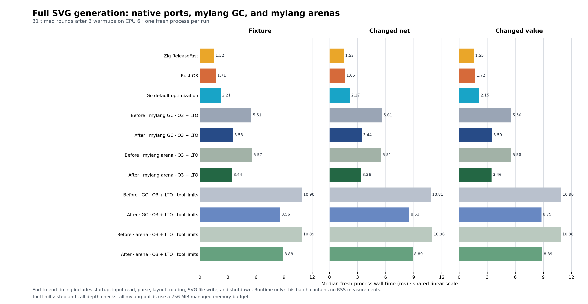

# Production fixes for the remaining SVG gap

Implemented copied block I/O, checked aggregate reads and scalar projections,
and the validated net-lookup cache. Full-render elapsed time falls **36–39%**
across the three benchmark inputs. The fixture now takes **3.530 ms with GC** or
**3.436 ms with arenas**, compared with **1.517 ms for the identical-output Zig
port**. This closes about half of the previous GC-versus-Zig absolute gap in
this batch, but it does **not** establish native performance parity.

[Vector chart](figures/full-svg-gap-fixes-2026-09-21.svg) ·
[Raw measurements](../../experiments/svg-gap-fixes-20260921/measurements.json) ·
[Reproduction instructions](../../experiments/svg-gap-fixes-20260921/README.md)

## Matched results

Every row was rerun in the same randomized, interleaved batch. Times are median
milliseconds for a fresh process through complete SVG file output and shutdown.
The mylang policies use LLVM O3 plus LTO. Compilation, preparation and output
verification are outside the timer; input reads, parsing, layout, routing,
rendering and file output are inside it.

| Implementation | Fixture | Changed net | Changed value |
|---|---:|---:|---:|
| Zig direct port, ReleaseFast | 1.517 | 1.516 | 1.550 |
| Rust port, O3 | 1.707 | 1.652 | 1.716 |
| Go port, default optimization | 2.214 | 2.168 | 2.145 |
| Before: mylang GC | 5.506 | 5.614 | 5.564 |
| After: mylang GC | 3.530 | 3.436 | 3.505 |
| Before: mylang arena | 5.573 | 5.511 | 5.556 |
| After: mylang arena | 3.436 | 3.360 | 3.456 |
| Before: GC with tool limits | 10.899 | 10.811 | 10.902 |
| After: GC with tool limits | 8.557 | 8.529 | 8.792 |
| Before: arena with tool limits | 10.892 | 10.965 | 10.880 |
| After: arena with tool limits | 8.884 | 8.889 | 8.891 |

For the fixture, GC improves **35.9%** (95% paired bootstrap interval:
**34.5–38.7%**) and arenas improve **38.4%** (**37.2–40.2%**). The bounded policies
improve **21.5%** and **18.4%**, respectively. These are combined production
improvements, not a sum of isolated experimental percentages.

The new GC build still takes **2.33× Zig, 2.07× Rust and 1.59× Go**. The arena
build takes **2.26× Zig**. Ordinary GC versus arena differences are small and
their ratio intervals include equality on all three inputs. This batch does not
demonstrate a consistent arena speed advantage.

The batch uses 31 timed rounds after 3 warmups, CPU 6, eleven arms and three
inputs: **1,023 timed renders**, each with exact SVG hash verification. Mylang
uses a 256 MiB memory limit. The arena versions wrap the whole invocation in an
arena region; the GC versions do not. Tool-limit builds retain instruction-step
and call-depth checks and run with a 100-million-step budget. The native ports
are the retained same-output implementations, not the EDA NetLisp renderer,
whose output differs. This batch measures runtime, not RSS.

## Implementation

- **Copied bulk host calls:** native provider ABI 6 adds an optional packed
  callback for integer scalars and flat fixed byte arrays. The runtime validates
  schemas, logical node/depth quotas, call/work limits, grants and reentry. It
  copies arguments into runtime-owned scratch, zeroes output, validates output
  identity/size and publishes no result after a trap. Large scratch uses
  registered frame allocation so unwinding releases it. Unsupported shapes
  retain the checked node bridge. Payloads are byte-aligned and accessed through
  `memcpy`. External C providers must recompile; bundled providers are updated.
- **Schematic I/O:** each document is loaded once in 256-byte blocks and source
  spans retain its owned immutable bytes. SVG text and decimal values append to
  a managed buffer with a persistent failure flag and a 4 MiB limit. Block writes
  charge work before effects; `finish` checks buffered write failures. Overflow
  is rejected before any output is sent. The fixture's normal path now has
  **303 host calls**: 102 input blocks, 194 output blocks and seven setup/finish
  calls, versus the previous measured 105,060 byte-oriented calls.
- **Aggregate reads:** the compiler checks bounds and copies the exact native
  layout directly. An immediate uninterrupted field-read chain ending in a
  scalar loads only the selected field. Escaping records retain value snapshots;
  records with release obligations and zero-sized layouts retain conservative
  handling. Negative indices, diagnostics, GC roots, arena ownership and
  instruction accounting are preserved.
- **Net lookups:** layout reuses validated net indexes and cached passive/bridge
  facts while preserving normalized/raw namespaces, source order and tie rules.

The packed host contract is documented in
[packed host calls](../tooling/packed-host-calls.md). No new language syntax was
needed. Instruction-budget batching remains separate work; this change leaves
its exact accounting in place. The remaining bounded overhead is still large:
8.557 ms versus 3.530 ms for the fixture's GC policies. A new profile is needed
before assigning percentages of the remaining unbounded gap to individual
functions; the earlier byte-oriented profiles no longer describe this program.

## Validation and provenance

- 60 compiler tests, 64 native-build tests and 16 schematic integration tests
  pass. The final build gate passes all 88 checks.
- Packed host bridge tests pass under ASan/UBSan, covering copied-input
  isolation, zeroed output, malformed schemas, quotas, work inflation/exhaustion,
  reentry, callback failure, output pointer/size/count mutation and large scratch
  allocation/release. Provider tests verify failure on a small buffered
  `/dev/full` write at `finish`, and rejection before effects for bad counts and
  insufficient work.
- All four LLVM policies match the retained baseline's exact SVG, exit status
  and located issue output on ten cases, both normally and under GC stress.
  Cases include changed nets/values, swapped names, source/pin ordering,
  normalized/raw and NC namespace collisions, and an empty-net rejection.
- LLVM O3/LTO regressions verify aggregate snapshots across mutation/growth,
  managed fields under GC stress, both signs of invalid indices with the same
  source location, minimum signed integer formatting, negative decimal widths,
  exact buffer capacity, persistent overflow refusal and real write failures.
  Tiny step/frame budgets still reject on bounded builds.

[Validation evidence](../../experiments/svg-gap-fixes-20260921/validation.json)
links commands and logs. [Build records](../../experiments/svg-gap-fixes-20260921/builds.json)
retain compiler, source and binary hashes, exact commands and build receipts.
Private copies preserve the starting source tree, pre-change compiler, final
compiler and all timed binaries. Final source/compiler identities were checked
against those records after testing. Existing unrelated working-tree changes
were preserved.
