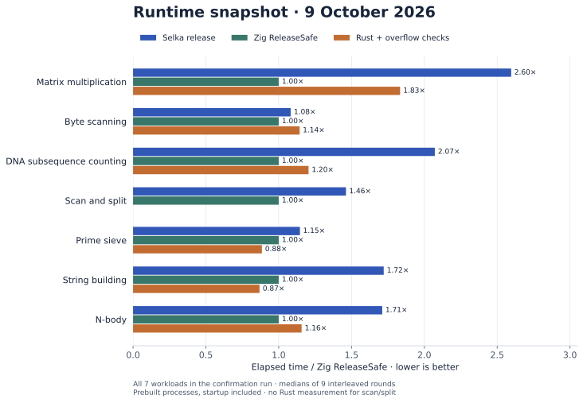
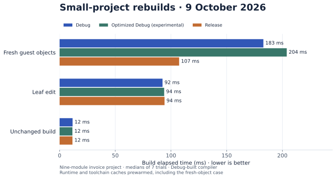

# Benchmarks and measured progress

Selka targets runtime performance competitive with Rust and Zig, and fast
incremental compilation and testing. These are complementary [design goals](goals.md).
This page separates execution time from build time so their tradeoffs are visible.

The results below are retained snapshots from 9 October 2026. They were collected
on different compiler snapshots and are not a fresh benchmark of the current
checkout. Charts are generated directly from the linked raw samples.
The retained evidence uses the former name `mylang`; the Selka labels on this
page and its charts refer to those same measurements.

## Native runtime



The table includes **all seven workloads** in the wall-time confirmation
experiment, using only the ordinary Selka, Zig ReleaseSafe, and Rust-with-overflow-
checks arms. Hand-edited LLVM and idealized C variants from the research report
are excluded: those investigate potential improvements, not shipped performance.

Median elapsed time in milliseconds; lower is better:

| Workload | Selka release | Zig ReleaseSafe | Rust + overflow checks | Selka / Zig |
| --- | ---: | ---: | ---: | ---: |
| Matrix multiplication | 144.23 | 55.55 | 101.86 | 2.60× |
| Byte scanning | 48.90 | 45.19 | 51.67 | 1.08× |
| DNA subsequence counting | 210.91 | 101.80 | 122.65 | 2.07× |
| Scan and split | 74.26 | 50.79 | — | 1.46× |
| Prime sieve | 78.18 | 68.24 | 60.36 | 1.15× |
| String building | 84.51 | 49.11 | 42.63 | 1.72× |
| N-body | 218.30 | 127.59 | 147.64 | 1.71× |

Selka ranged from 1.08× to 2.60× Zig ReleaseSafe's elapsed time in this snapshot.
Byte scanning is close; matrix multiplication and DNA counting leave larger
gaps. Rust also varies by workload. These measurements support workload-specific
conclusions, not a claim that one language is uniformly faster.

**Method.** Prebuilt native executables, including process startup and captured
stdout; compilation excluded. The harness uses CPU 10, two warmup rounds, and
nine measured rounds with shuffled, interleaved arms. It checks exit status and
output agreement once before timing; it does not revalidate each timed sample.
The table uses each arm's median, and the ratio divides those medians.
A dash means that arm was not measured.

**Identity and scope.** The report identifies the compiler as `a677da7a0`,
with code generation matching `cafe7fea7`. Zig uses ReleaseSafe; Rust uses an
optimized native-target build with overflow checks enabled. These settings make
some safety costs comparable without making the languages' semantics identical.
The confirmation record does not contain a complete machine/toolchain manifest;
its binary paths and build commands are retained in the evidence. Treat it as an
exploratory snapshot. Future headline runs should capture full machine metadata
and immutable toolchain/binary identities together.

- [Confirmation report](../experiments/parity-confirm-20261009/REPORT.md)
- [Raw samples](../experiments/parity-confirm-20261009/result.json),
  [invocations](../experiments/parity-confirm-20261009/spec.json), and
  [measurement script](../experiments/parity-confirm-20261009/tools/confirm.py)
- [Matched workload sources and reference build settings](../bench/parity/README.md)
- [Application profiles for Lox and electronic-design workloads](../experiments/parity-measure-20261008/REPORT.md#reference-ratios)

The application profiles report processor cycles in a separate experiment.
They are not combined with the wall-time ratios above.

## Incremental builds



The nine-module [invoice project](../examples/corpus/invoice/main.selka) exercises
imports, validation, and pricing. Here a leaf constant changes from 100 to 101.
Median build elapsed time in milliseconds:

| Mode | Fresh guest objects | Leaf edit | Unchanged build |
| --- | ---: | ---: | ---: |
| Debug | 183 | 92 | 12 |
| Optimized Debug (experimental) | 204 | 94 | 12 |
| Release | 107 | 94 | 12 |

After the edit, Debug and optimized Debug compiled one unit and reused nine.
An unchanged build replayed without launching a compiler or linker process.
Release rebuilt its whole-program unit. On this small project, Release had the
shortest fresh-object build; the edit times were similar in all three modes.
This experiment demonstrates reuse, not a universal speed advantage for one mode.

**Method.** Seven trials on Linux x86-64, Intel Core i7-12700H, CPU 2, using a
Debug-built compiler and Zig `0.17.0-dev.1683+5ceec001b`. Each trial used fresh
program and guest-object caches, but prewarmed runtime and toolchain caches:
“fresh guest objects” is not an empty-machine cold build. CPU frequency and
other host activity were not controlled. The compiler SHA-256, base commit
`dc036891867cd28d20798b1992a84cdc3436dc82`, source-diff hash, and individual
samples are recorded in the [raw results](../bench/parity/debug_speedup_20261009.json).

Optimized Debug is experimental. The same snapshot includes six runtime
workloads where it approached Release's speed, with additional build work and
possible caller invalidation. See [performance modes and qualification](performance.md#optimized-debug-prototype-measurements)
for those results and the separate debugger limitations.

[Measurement driver](../scripts/benchmark_debug_runtime.py) ·
[Invoice sources](../examples/corpus/invoice/) ·
[Build and cache behavior](tooling/native-build.md)

## Testing and agent development speed

The test runner supports isolated trials, property tests, deterministic capability
stand-ins, cached successful results, and affected-test selection. The goal is to
make substantial integration tests affordable throughout an agent's edit loop.
See [the test workflow](tooling/guest-tests.md).

The build timings above do **not** measure test-suite latency or end-to-end agent
productivity. Those need separate measurements of representative edits through
verification, including failures, repairs, and context retrieval. Earlier
[agent development trials](experiments/velocity-iteration-v1-results.md) remain
historical observations on a different language/runtime version.

## Updating these snapshots

Use matched sources and inputs, check output against independent expectations,
and retain failures as well as successes. Record compiler and reference revisions,
full build flags, CPU/OS/toolchain information, safety settings, cache state,
warmups, rounds, and raw samples. Measure prebuilt execution separately from
compilation; distinguish cold builds, unchanged builds, edited builds, and tests.

Keep normal compiler outputs separate from diagnostic variants that remove
checks or alter runtime semantics. Record all workloads in the chosen suite and
explain missing arms. Keep older results dated instead of relabelling them as a
measurement of a newer compiler.

To regenerate these two figures from retained data, run Python with matplotlib:

```bash
python3 docs/figures/render_showcase.py
```

This renders the charts; it does not run benchmarks. For a new timing session,
use the [parity harness](../bench/parity/README.md) and the
[debug-build measurement driver](../scripts/benchmark_debug_runtime.py), with
fresh result paths and the machine's benchmark scheduling rules.
